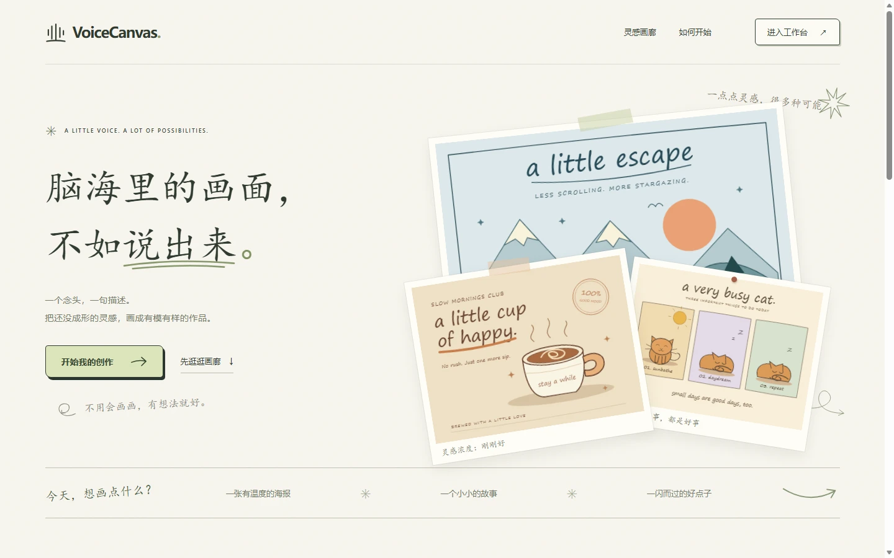

# VoiceCanvas

**用语音或文字创建可编辑的 SVG 分镜。**

VoiceCanvas 面向需要向摄影师、剪辑师或团队说明画面想法的内容创作者。用户描述故事、镜头数量、时长和关键动作，Agent 自主选择工具，创建独立镜头并生成自由 SVG；之后可以调整顺序、继续改画、直接修改对白和字幕，导出 PNG 或 SVG。

## 界面预览


工作台截图来自真实模型生成的「雨天咖啡」三镜头项目。每个镜头可单独改画、编辑文字和导出。



## 能做什么

| 用户任务 | 当前能力 |
| --- | --- |
| 描述一段完整故事 | Agent 自主拆镜，保存每镜的拍摄说明、景别和时长；每镜独立生成 |
| 持续调整分镜 | 语音或文字管理镜头、改画、排序、复制；删除前确认 |
| 修改对白、字幕或招牌 | 直接编辑已有 SVG 文字、字号与换行，预览后保存，无需请求模型 |
| 检查关键动作 | Agent 可选用真实图片渲染与同模型看图评审，指出偏差，再决定是否修改 |
| 保存和交付 | SQLite 持久化、画面与分镜结构独立撤销、刷新恢复、PNG/SVG 下载 |

试着输入：

> 给咖啡店拍一条15秒雨天促销短片，分3个镜头：女孩雨中进店、店员递咖啡、产品特写。女孩穿黄色雨衣，店员穿白衬衫绿围裙。最后写“雨天咖啡买一送一”。保存每镜景别和时长。

随后可以说“把第二个镜头移到最后”，或“检查递杯镜头中女孩是否握住杯柄，指出具体偏差”。这些是需求示例，Agent 通过模型原生工具调用决定执行方式，没有固定句式路由或预设分镜模板。

## 本地运行

准备 Python 3.11+、uv、Node.js 20+，以及支持工具调用的 OpenAI-compatible 模型 API 密钥。已验证 `deepseek/deepseek-v4.1-flash`。语音和文字使用同一个 Agent。画廊、分镜管理和直接改字可在本机使用，生成画面和图片评审需要模型服务。

终端一，从仓库根目录启动后端：

```powershell
cd backend
if (-not (Test-Path .env)) { Copy-Item .env.example .env }
# 在 .env 中填入 VOICECANVAS_SHOT_LLM_API_KEY；已有 .env 时直接编辑，勿覆盖。
uv sync --frozen --no-editable
$env:PYTHONPATH="src"
uv run --frozen --no-editable uvicorn voicecanvas.api.main:app --host 127.0.0.1 --port 8000
```

终端二，从仓库根目录启动前端：

```powershell
cd frontend
npm run prototype
```

前端使用 Node 内置静态服务，这一步无需 `npm install`。打开 [首页](http://127.0.0.1:4178/index.html)，点击“开始我的创作”。后端健康检查为 [GET /health](http://127.0.0.1:8000/health)。可选看图工具需要服务端已安装 Edge/Chromium；具体配置、数据保存和 Docker 边界见[部署指南](docs/DEPLOYMENT.md)。

## 工程实现与能力边界

项目实现了工具调用执行与交付核对、SVG 白名单及原子源码修改、独立版本历史、并发冲突处理、任务持久化恢复，以及直接文字编辑的测量和保存闭环。领域与应用层通过协议隔离模型、浏览器、数据库和 HTTP。

FastAPI 和 Pydantic 提供 API 与数据校验，SQLite 保存分镜与版本，HTTPX 调用模型 API。画面构图、SVG 绘制、自然语言决策和图片评审由外部模型完成。语音识别和播报使用浏览器 Web Speech API，服务端看图工具使用 Chromium 或 Edge 渲染。内置作画知识改编自第三方 skill。[依赖与原创边界](docs/技术选型与依赖声明.md)

复杂人物动作、手与物体接触和跨镜角色一致性需要人工检查。在递杯实测中，模型识别了握杯偏差，一次修正后仍有问题。[原始输出、耗时与失败样本](docs/experiments/README.md)

## 阅读与验证

| 想了解什么 | 文档 |
| --- | --- |
| 如何创作、改字、恢复和导出 | [使用指南](docs/使用指南.md) |
| 环境变量、网络、数据库、Docker | [部署指南](docs/DEPLOYMENT.md) |
| Agent 如何决策，状态如何保存 | [架构说明](docs/ARCHITECTURE.md) |
| 具体接口、参数和错误语义 | [API 说明](docs/API.md) |
| 如何运行回归和浏览器验收 | [测试指南](docs/TESTING.md) |
| 第三方能力、许可与自研范围 | [依赖与原创边界](docs/技术选型与依赖声明.md) |

基础回归分别从仓库根目录执行：

```powershell
cd backend
uv run --frozen --no-editable pytest -q
```

```powershell
cd frontend
npm test
```

欢迎提交问题和改进建议。反馈绘图偏差时，请附上提示词、模型名称和对应镜头截图。[GitHub Issues](https://github.com/jackwentao/VoiceCanvas/issues)
