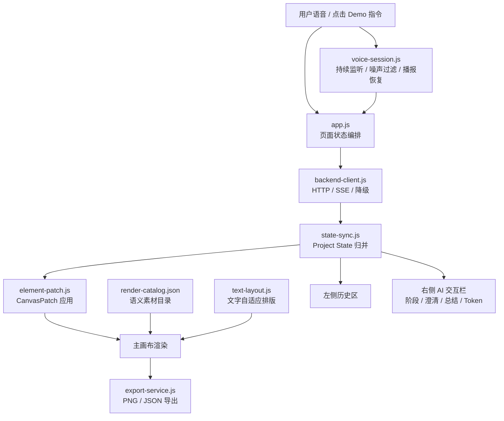
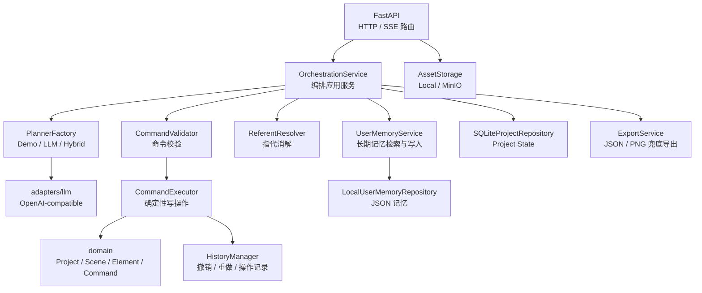
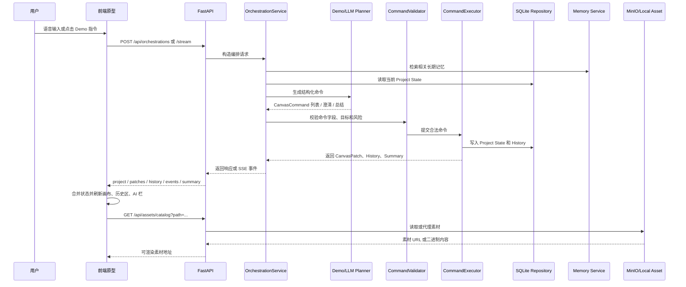

# VoiceCanvas

## 单镜头创作实验入口

新增 `http://127.0.0.1:4178/shot.html`：描述一个镜头，由模型直接生成完整 SVG，再通过自然语言提出局部修改，支持持久化、撤销/重做、SVG 与 PNG 导出。此路径不依赖预设对象库，目标是先验证一个镜头的画面质量和编辑闭环。

启动沿用下方后端与前端命令；本入口的静态服务无需先安装 npm 依赖。先在 `backend` 将 `.env.example` 复制为 `.env`，配置 `VOICECANVAS_SHOT_LLM_API_KEY`。示例端点为 `https://api.commandcode.ai/provider/v1`，模型为 `deepseek/deepseek-v4.1-flash`；也可替换为其他兼容端点。默认最大输出预算 32768、超时 300 秒，无自动付费重试。调用失败保留上一版画面。

语音输入会先填入文本框，检查后点击提交；此入口目前仍需要手动操作。画面审美依赖外部模型，当前不包含自动视觉自审。项目实现生成/修改协议、SVG 校验、原子版本提交、持久化与编辑交互，不将模型绘图能力表述为原创模型能力。

测试：后端运行 `uv run --no-editable pytest tests/test_single_shot.py -q`，前端运行 `npm test`。完整 API、配置、依赖边界及验收步骤见 [单镜头创作说明](docs/单镜头创作.md)。下文保留的纯语音、结构化多镜头功能说明对应原有 `index.html` 入口。

人物与动作的初次生成提示采用“先完成主体轮廓、接触关系和表情，再补环境”的简短优先级。两场景六次真实调用的 [对照结果](docs/experiments/subject-quality-20261117/README.md) 含一次预算截断；小样本尚不能证明画质稳定提升，人物肢体连接仍有缺陷。

项目绘图 Agent 现默认加载内置 `svg-illustration` skill：从公开的 SVG Creator（Apache-2.0）和 Vector Illustration（MIT）精简改编，按生成／修改阶段提供构图、连接、光影和局部编辑知识。设置 `VOICECANVAS_SHOT_DRAWING_SKILL=none` 并重启后端可关闭。它是项目运行时的一部分，无需给 Codex 安装个人 skill；当前接入的是文字知识，没有接通原技能的多轮看图自审。来源、许可证、改编边界与验证方式见 [绘图技能接入](docs/绘图技能接入.md)。

另完成一次 [真实渲染、局部放大与两轮视觉修图实验](docs/experiments/visual-review-20261117/README.md)：五次模型调用合计约 261 秒、56,421 token，手形略改善，蹲姿与腿部连接仍未解决。模型自审有与图片不符的描述，因此目前只保存对照和请求记录，尚未将该循环接入产品自动提交。

VoiceCanvas 是一款面向内容创作者的 **纯语音可编辑分镜草图工具**，参赛题目为七牛云 XEngineer「AI 语音绘图工具」。

它解决的不是“一句话生成一张不可编辑图片”，而是让用户在创作前期用语音持续完成分镜创建、元素添加、元素修改、澄清确认、撤销重做和导出交付。

> **Demo 视频：** [https://www.bilibili.com/video/BV1yDJA6eEjv/?vd_source=dacd206dccc43e8dc0882c384d22773d](https://www.bilibili.com/video/BV1yDJA6eEjv/?vd_source=dacd206dccc43e8dc0882c384d22773d)

## 一句话说明

VoiceCanvas 不是 Voice-to-Image，而是 **Voice-to-Editable-Storyboard**。

用户首次进入应用时需要点击一次按钮完成浏览器麦克风授权；授权后，从第一条绘图指令到作品导出，核心创作链路都可以通过语音完成。

## 当前可验证能力

- 创建三镜头带货分镜，生成结构化镜头、标题、字幕、商品、标签和说明。
- 通过语音切换镜头、新增元素、修改文字、调整颜色、移动或缩放元素。
- 添加箭头和连接线，表达商品、标签、卖点之间的关系。
- 对“它”“那个”等不明确指令进入澄清流程，并在用户回答后恢复任务。
- 支持撤销、重做和高风险清空画布确认。
- 支持导出当前画面 PNG 和项目 JSON，并可从 JSON 重新载入可编辑项目。
- 后端持久化 Project State 到 SQLite，服务重启后仍可读取项目。
- 支持本地 Demo Planner，也支持 OpenAI-compatible 真实 LLM Planner，可失败重试并按配置降级。
- 支持 Render Catalog 素材代理，MinIO 模式下由后端校验并代理读取素材包。
- 支持用户长期记忆 MVP，保存和检索用户命名、布局、风格偏好。

## 项目结构

```text
VoiceCanvas/
  frontend/  原生 HTML/CSS/JavaScript 前端原型、语音会话、画布渲染、导出与契约测试
  backend/   Python + FastAPI + LangGraph 后端，承载可信状态、命令执行、编排和存储适配
  docs/      产品、架构、接口、依赖、指令验收和提交记录
  Dockerfile 后端 API 镜像
```

## 快速启动

以下命令默认在仓库根目录 `projects/VoiceCanvas` 执行。

### 1. 启动后端

```powershell
cd backend
uv sync --no-editable
$env:PYTHONPATH="src"
uv run --no-editable uvicorn voicecanvas.api.main:app --reload
```

健康检查：

```text
http://127.0.0.1:8000/health
```

默认配置使用：

- `VOICECANVAS_PLANNER=demo`：离线稳定演示，不依赖真实 LLM。
- `VOICECANVAS_ASSET_PROVIDER=local`：素材读取走本地/占位降级，不要求启动 MinIO。
- `backend/data/voicecanvas.sqlite3`：默认 SQLite 项目状态数据库。
- `backend/data/user-memory.json`：默认长期记忆 JSON 仓储。

### 2. 启动前端

另开一个终端：

```powershell
cd frontend
npm install
npm run prototype
```

访问：

```text
http://127.0.0.1:4178/index.html
```

前端默认连接 `http://127.0.0.1:8000`。如后端运行在其他端口，可用查询参数切换：

```text
http://127.0.0.1:4178/index.html?apiBaseUrl=http://127.0.0.1:8001
```

## MinIO 素材包启动

比赛现场如果要验证后端代理 MinIO 素材链路，可用 Docker 启动 MinIO。

### 1. 启动 MinIO

```powershell
docker run --rm --name voicecanvas-minio `
  -p 9000:9000 `
  -p 9001:9001 `
  -e MINIO_ROOT_USER=voicecanvas `
  -e MINIO_ROOT_PASSWORD=voicecanvas123 `
  quay.io/minio/minio server /data --console-address ":9001"
```

MinIO 控制台：

```text
http://127.0.0.1:9001
```

### 2. 配置后端环境变量

```powershell
cd backend
$env:VOICECANVAS_ASSET_PROVIDER="minio"
$env:VOICECANVAS_MINIO_ENDPOINT="127.0.0.1:9000"
$env:VOICECANVAS_MINIO_BUCKET="voicecanvas-assets"
$env:VOICECANVAS_MINIO_ACCESS_KEY="voicecanvas"
$env:VOICECANVAS_MINIO_SECRET_KEY="voicecanvas123"
$env:VOICECANVAS_MINIO_SECURE="false"
```

### 3. 下载并上传 Render Catalog 素材

```powershell
uv run --no-editable python scripts/download_real_catalog_assets.py --overwrite
uv run --no-editable python scripts/seed_minio_catalog.py --asset-root ".\data\real-assets"
uv run --no-editable python scripts/check_minio_catalog.py --strict
```

素材路径统一位于 `catalog/commerce/` 前缀下，例如：

```text
catalog/commerce/food-drink/bubble-tea.png
catalog/commerce/digital/smartphone.png
```

后端启动时如果 `VOICECANVAS_ASSET_PROVIDER=minio`，会默认检查素材包完整性；缺失任意 Catalog 素材时服务会拒绝启动并列出缺失路径。临时调试时可设置：

```powershell
$env:VOICECANVAS_SKIP_MINIO_CATALOG_CHECK="true"
```

## Docker 验证后端

仓库根目录提供后端 Dockerfile。

```powershell
docker build -t voicecanvas-backend .
docker run --rm --name voicecanvas-backend -p 8000:8000 `
  -e VOICECANVAS_PROJECT_DB_PATH=/app/backend/data/voicecanvas.sqlite3 `
  voicecanvas-backend
```

如果需要让容器后端连接宿主机 MinIO，可使用 `host.docker.internal:9000`：

```powershell
docker run --rm --name voicecanvas-backend -p 8000:8000 `
  -e VOICECANVAS_ASSET_PROVIDER=minio `
  -e VOICECANVAS_MINIO_ENDPOINT=host.docker.internal:9000 `
  -e VOICECANVAS_MINIO_BUCKET=voicecanvas-assets `
  -e VOICECANVAS_MINIO_ACCESS_KEY=voicecanvas `
  -e VOICECANVAS_MINIO_SECRET_KEY=voicecanvas123 `
  -e VOICECANVAS_MINIO_SECURE=false `
  voicecanvas-backend
```

前端仍按本地方式启动，并访问 `http://127.0.0.1:4178/index.html`。

## 真实 LLM 配置

默认 Demo Planner 不需要 API Key。需要验证真实模型时：

```powershell
cd backend
$env:VOICECANVAS_PLANNER="hybrid"
$env:VOICECANVAS_LLM_BASE_URL="https://你的-openai-compatible-endpoint/v1"
$env:VOICECANVAS_LLM_MODEL="你的模型名"
$env:VOICECANVAS_LLM_API_KEY="你的 API Key"
$env:VOICECANVAS_LLM_MAX_ATTEMPTS="3"
$env:VOICECANVAS_LLM_TIMEOUT_SECONDS="20"
$env:PYTHONPATH="src"
uv run --no-editable uvicorn voicecanvas.api.main:app --reload
```

Planner 模式：

| 模式 | 说明 |
| --- | --- |
| `demo` | 默认模式，使用本地确定性演示 Planner，适合离线评审和录屏 |
| `llm` | 只使用真实 LLM，失败后返回错误，不自动降级 |
| `hybrid` | 优先真实 LLM，额度不足、网络失败、超时、格式错误或业务校验失败后降级到 Demo Planner |

真实 LLM 只负责把自然语言转成结构化命令；所有写操作仍必须经过 Pydantic 结构校验、`CommandValidator` 和 `CommandExecutor`，不能直接覆盖 Project State。

## 常用 API 验证

```powershell
Invoke-RestMethod -Method Get -Uri "http://127.0.0.1:8000/health"
```

```powershell
Invoke-RestMethod `
  -Method Post `
  -Uri "http://127.0.0.1:8000/api/orchestrations" `
  -ContentType "application/json" `
  -Body '{"projectId":"project_demo_voicecanvas","userInput":"创建一个三镜头的珍珠奶茶带货分镜，主打低糖和新品上市"}'
```

```powershell
Invoke-RestMethod `
  -Method Get `
  -Uri "http://127.0.0.1:8000/api/projects/project_demo_voicecanvas"
```

```powershell
Invoke-RestMethod `
  -Method Post `
  -Uri "http://127.0.0.1:8000/api/projects/project_demo_voicecanvas/export" `
  -ContentType "application/json" `
  -Body '{"format":"json","scope":"project"}'
```

```powershell
Invoke-RestMethod `
  -Method Post `
  -Uri "http://127.0.0.1:8000/api/projects/project_demo_voicecanvas/export" `
  -ContentType "application/json" `
  -Body '{"format":"png","scope":"active_scene"}'
```

SSE 流式编排：

```powershell
$body = @{
  projectId = "project_demo_voicecanvas"
  userInput = "创建一个三镜头的珍珠奶茶带货分镜，主打低糖和新品上市"
} | ConvertTo-Json -Compress

curl.exe -N `
  -X POST "http://127.0.0.1:8000/api/orchestrations/stream" `
  -H "Content-Type: application/json" `
  --data $body
```

## 测试命令

前端契约测试：

```powershell
cd frontend
npm run test:prototype
```

后端全量测试和质量检查：

```powershell
cd backend
uv sync --no-editable
uv run --no-editable pytest
uv run --no-editable ruff check .
uv run --no-editable mypy src
```

重点链路测试：

```powershell
cd backend
uv run --no-editable pytest tests/test_orchestration_service.py tests/test_command_executor.py tests/test_command_validator.py
uv run --no-editable pytest tests/test_export_service.py tests/test_render_catalog.py tests/test_minio_catalog_seed.py
uv run --no-editable pytest tests/test_user_memory_repository.py tests/test_user_memory_service.py tests/test_memory_extractor.py tests/test_user_memory_api.py
```

真实 LLM 验收测试默认跳过；需要实际调用时显式开启：

```powershell
cd backend
$env:VOICECANVAS_RUN_REAL_LLM_TESTS="1"
$env:VOICECANVAS_LLM_BASE_URL="https://你的-openai-compatible-endpoint/v1"
$env:VOICECANVAS_LLM_MODEL="你的模型名"
$env:VOICECANVAS_LLM_API_KEY="你的 API Key"
uv run --no-editable pytest tests/test_real_llm_command_planner.py -s
```

## 前端架构



前端只负责交互体验、画布投影、导出入口和降级展示；不持有后端可信业务规则。后端不可用时，前端会记录 `BACKEND_REQUEST_FAILED` 并回退到本地演示链路，保证比赛现场仍可展示基本流程。

## 后端架构



后端核心原则：

- AI 负责理解和规划，系统负责确定性执行。
- 所有画布写操作都经过 `CommandValidator` 和 `CommandExecutor`。
- Project State 是唯一可信状态，前端 CanvasPatch 只是 UI 增量投影。
- LLM、MinIO、未来七牛云能力都通过 adapter 接入，领域层不依赖外部 SDK。

## 数据完整流转



## 指令能力边界

完整指令验收基线见 [Demo 脚本与指令能力验收](./docs/Demo脚本与指令能力验收.md)，预计实现、已完成、部分完成和未完成原因见 [指令完成情况](./docs/指令完成情况.md)。

当前 README 只保留评审视角的边界：

- MVP 已覆盖创建分镜、镜头切换、文字/商品/标签/箭头添加、内容修改、视觉属性修改、位置调整、删除、澄清、撤销、重做、清空确认、JSON/PNG 导出、未知元素占位、长期记忆基础能力。
- 长图导出属于 P1，当前不作为 MVP 通过条件。
- 任意复杂图像生成质量、PS/Figma 级精细图层编辑、多人协作、无限步 AI 自动规划不在本次 MVP 承诺范围内。
- 普通编辑操作不依赖生图模型；未知对象会先落为结构化占位，保证创作链路不中断。

## 文档索引

- [Demo 脚本与指令能力验收](./docs/Demo脚本与指令能力验收.md)
- [指令完成情况](./docs/指令完成情况.md)
- [技术架构设计](./docs/技术架构设计.md)
- [接口与数据模型设计](./docs/接口与数据模型设计.md)
- [前端交互原型与接口绑定设计](./docs/前端交互原型与接口绑定设计.md)
- [技术选型与依赖声明](./docs/技术选型与依赖声明.md)
- [长期记忆 MVP 决策](./docs/长期记忆MVP决策.md)
- [产品决策记录](./docs/产品决策记录.md)
- [PR 提交记录](./docs/PR提交记录.md)

## 依赖边界

| 位置 | 依赖 | 用途与边界 |
| --- | --- | --- |
| `frontend/package.json` | `express` | 本地原型静态服务 |
| `frontend/package.json` | `cors`、`zod` | 本地跨端口调试和前端契约校验准备 |
| `frontend/package.json` | `typescript`、`tsx`、`vitest`、`supertest` | 前端脚本、类型和测试工具 |
| `backend/pyproject.toml` | `fastapi`、`uvicorn[standard]` | 后端 HTTP API 与本地服务运行 |
| `backend/pyproject.toml` | `pydantic` | 领域模型、请求响应和命令校验 |
| `backend/pyproject.toml` | `langgraph`、`langchain-core` | 可恢复 AI 编排和 LLM 适配基础类型 |
| `backend/pyproject.toml` | `httpx`、`python-dotenv` | 外部 HTTP 调用与环境变量加载 |
| `backend/pyproject.toml` | `minio` | MinIO 素材读取适配器，仅在存储层使用 |
| `backend/pyproject.toml` | `pytest`、`pytest-asyncio`、`respx`、`ruff`、`mypy` | 后端测试、Mock、lint 和类型检查 |
| Python 标准库 | `sqlite3`、`json`、`pathlib` | Project State 和长期记忆本地持久化 |
| 浏览器原生 API | Web Speech API、SpeechSynthesis、Canvas、Blob、Fetch、ReadableStream | 语音入口、播报、画布导出、SSE 消费，不参与后端可信状态判断 |
| 外部服务 | OpenAI-compatible LLM API | 可选真实 Planner，失败可降级到 Demo Planner |
| 外部服务 | MinIO | 可选素材桶验证，前端不直连 MinIO，不接触存储凭证 |

第三方框架只作为服务运行、模型校验、编排基础设施、存储适配和测试工具使用；VoiceCanvas 的业务规则、画布状态变更、命令语义、导出闭环和演示工作流为本项目原创实现。
