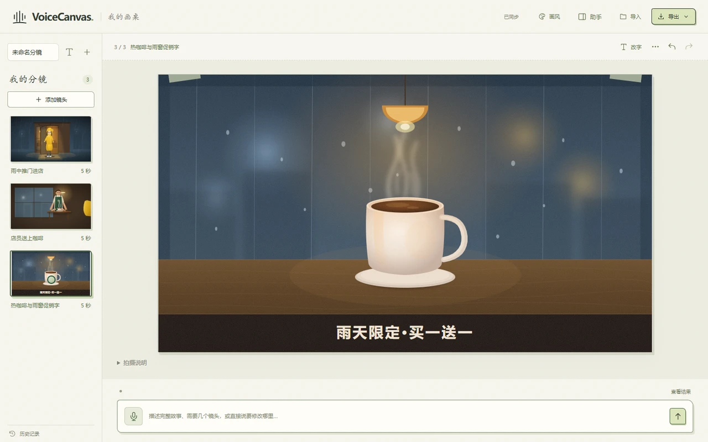
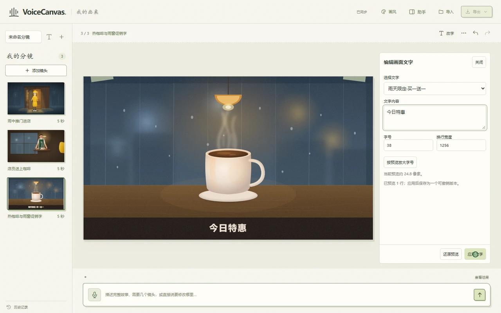
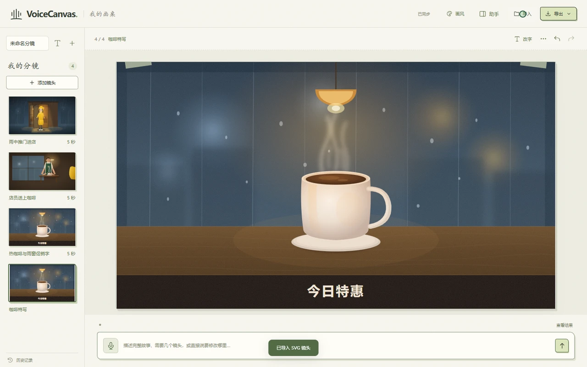
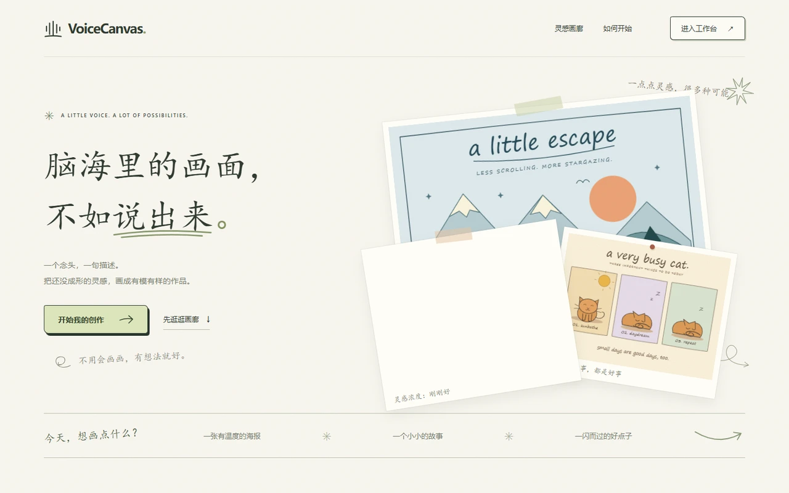
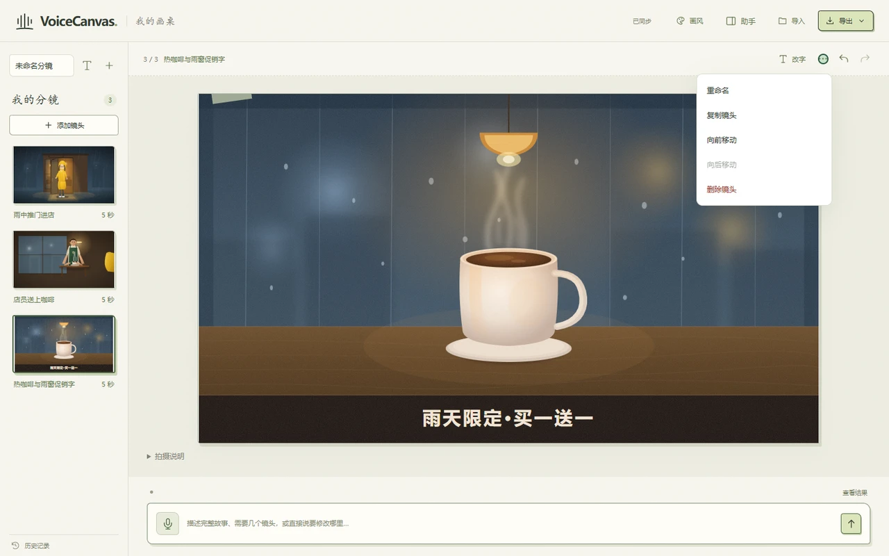

# VoiceCanvas

**一句话语音或文本生成多镜头分镜 → 局部编辑修改 → 导出画面。**

VoiceCanvas 帮短视频创作者把拍摄想法变成可以逐镜讨论和修改的分镜。描述故事、时长和关键动作后，Agent 会拆分镜头，生成画面并保存拍摄说明。开拍前可以调整顺序、修改字幕，再把镜头交给拍摄或剪辑团队。

[架构设计](docs/ARCHITECTURE.md) · [演示视频](#视频演示) · Cloudflare 在线体验（待部署）

## 视频演示

[](https://raw.githubusercontent.com/jackwentao/VoiceCanvas/main/docs/demo/voicecanvas-demo.mp4)

[播放或下载 MP4](https://raw.githubusercontent.com/jackwentao/VoiceCanvas/main/docs/demo/voicecanvas-demo.mp4) · [图文演示](#图文演示)

视频从首页进入新版工作台，再打开先前由真实模型生成的「雨天咖啡」项目，演示镜头管理、直接改字、SVG 导出与导入，以及保存默认画风。

| 查看镜头 | 局部编辑 | 导回导出的 SVG |
| --- | --- | --- |
|  |  |  |

## 图文演示

### 1. 从首页开始

点击「开始我的创作」进入空白工作台。可以点选「雨天咖啡」填入示例，也可以通过麦克风或输入框提交自己的需求。



> 给咖啡店拍一条15秒雨天促销短片，分3个镜头：女孩雨中进店、店员递咖啡、产品特写。女孩穿黄色雨衣，店员穿白衬衫绿围裙。最后写“雨天咖啡买一送一”。保存每镜景别和时长。

### 2. 查看和调整镜头

左侧缩略图用于切换镜头，顶部显示当前镜头的位置和名称。「镜头操作」里可以重命名、复制、移动或删除，「历史记录」提供分镜结构的撤销和重做。创作任务开始后，助手展示实际进度和结果。



### 3. 预览和保存文案

点画布上方的「改字」，选中字幕或对白，调整内容、字号和换行宽度。确认画面上的即时预览后，点击「应用改字」。每次保存会创建独立画面版本。


### 4. 下载镜头，或导回接着做

右上角「导出」提供 PNG 和 SVG。PNG 适合发给团队看，自包含 SVG 可以通过「导入」重新加入当前项目，继续编辑文字和画面。整组导出会逐镜下载。常用风格可在「画风」里保存，同一浏览器的新项目可以沿用，本次明确指定的画风优先。


## 本地运行

准备 Python 3.11+、uv、Node.js 20+，以及支持工具调用的 OpenAI-compatible 模型 API 密钥。已验证 `deepseek/deepseek-v4.1-flash`。语音和文字使用同一个 Agent。画廊、分镜管理和直接改字可在本机使用，生成画面和图片评审需要模型服务。

终端一，从仓库根目录启动后端：

```powershell
cd backend
if (-not (Test-Path .env)) { Copy-Item .env.example .env }
# 在 .env 中填入 VOICECANVAS_SHOT_LLM_API_KEY；已有 .env 时直接编辑，勿覆盖。
uv sync --frozen --no-editable
$env:PYTHONPATH="src"
uv run --frozen --no-editable uvicorn voicecanvas.api.main:app --host 127.0.0.1 --port 8000
```

终端二，从仓库根目录启动前端：

```powershell
cd frontend
npm run prototype
```

前端使用 Node 内置静态服务，这一步无需 `npm install`。打开 [首页](http://127.0.0.1:4178/index.html)，点击“开始我的创作”。后端健康检查为 [GET /health](http://127.0.0.1:8000/health)。可选看图工具需要服务端已安装 Edge/Chromium；具体配置、数据保存和 Docker 边界见[部署指南](docs/DEPLOYMENT.md)。

## 工程实现

项目实现了工具调用执行与交付核对、SVG 白名单及原子源码修改、独立版本历史、并发冲突处理、任务持久化恢复，以及直接文字编辑的测量和保存闭环。领域与应用层通过协议隔离模型、浏览器、数据库和 HTTP。

FastAPI 和 Pydantic 提供 API 与数据校验，SQLite 保存分镜与版本，HTTPX 调用模型 API。画面构图、SVG 绘制、自然语言决策和图片评审由外部模型完成。语音识别和播报使用浏览器 Web Speech API，服务端看图工具使用 Chromium 或 Edge 渲染。内置作画知识改编自第三方 skill。[依赖与原创边界](docs/技术选型与依赖声明.md)

复杂人物动作、手与物体接触和跨镜角色一致性需要人工检查。在递杯实测中，模型识别了握杯偏差，一次修正后仍有问题。[原始输出、耗时与失败样本](docs/experiments/README.md)

## 阅读与验证

| 想了解什么 | 文档 |
| --- | --- |
| 如何创作、改字、恢复和导出 | [使用指南](docs/使用指南.md) |
| 环境变量、网络、数据库、Docker | [部署指南](docs/DEPLOYMENT.md) |
| Agent 如何决策，状态如何保存 | [架构说明](docs/ARCHITECTURE.md) |
| 具体接口、参数和错误语义 | [API 说明](docs/API.md) |
| 如何运行回归和浏览器验收 | [测试指南](docs/TESTING.md) |
| 第三方能力、许可与自研范围 | [依赖与原创边界](docs/技术选型与依赖声明.md) |

基础回归分别从仓库根目录执行：

```powershell
cd backend
uv run --frozen --no-editable pytest -q
```

```powershell
cd frontend
npm test
```

欢迎提交问题和改进建议。反馈绘图偏差时，请附上提示词、模型名称和对应镜头截图。[GitHub Issues](https://github.com/jackwentao/VoiceCanvas/issues)
