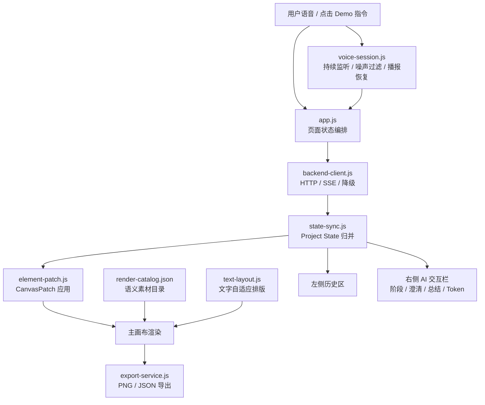
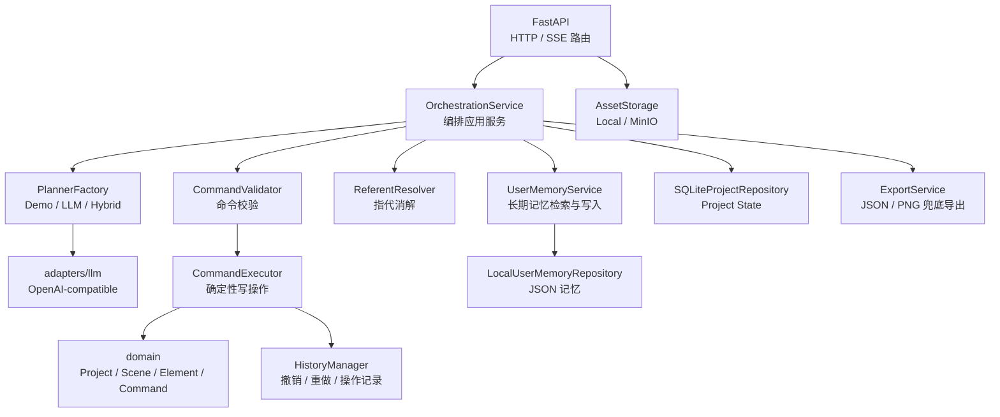
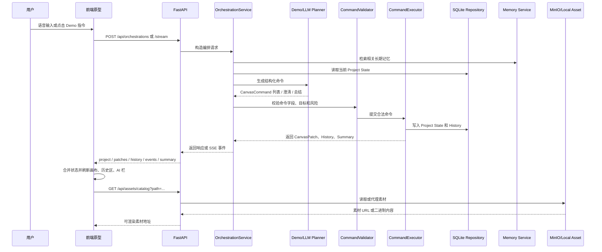

# VoiceCanvas 运行架构

[返回项目首页](../README.md)

## 前端架构

前端只负责交互体验、画布投影、导出入口和降级展示；不持有后端可信业务规则。后端不可用时，前端会记录 `BACKEND_REQUEST_FAILED` 并回退到本地演示链路，保证比赛现场仍可展示基本流程。

## 后端架构

后端核心原则：

- AI 负责理解和规划，系统负责确定性执行。
- 所有画布写操作都经过 `CommandValidator` 和 `CommandExecutor`。
- Project State 是唯一可信状态，前端 CanvasPatch 只是 UI 增量投影。
- LLM、MinIO、未来七牛云能力都通过 adapter 接入，领域层不依赖外部 SDK。

## 数据完整流转

## 指令能力边界

完整指令验收基线见 [Demo 脚本与指令能力验收](./Demo脚本与指令能力验收.md)，预计实现、已完成、部分完成和未完成原因见 [指令完成情况](./指令完成情况.md)。

当前 README 只保留评审视角的边界：

- MVP 已覆盖创建分镜、镜头切换、文字/商品/标签/箭头添加、内容修改、视觉属性修改、位置调整、删除、澄清、撤销、重做、清空确认、JSON/PNG 导出、未知元素占位、长期记忆基础能力。
- 长图导出属于 P1，当前不作为 MVP 通过条件。
- 任意复杂图像生成质量、PS/Figma 级精细图层编辑、多人协作、无限步 AI 自动规划不在本次 MVP 承诺范围内。
- 普通编辑操作不依赖生图模型；未知对象会先落为结构化占位，保证创作链路不中断。
