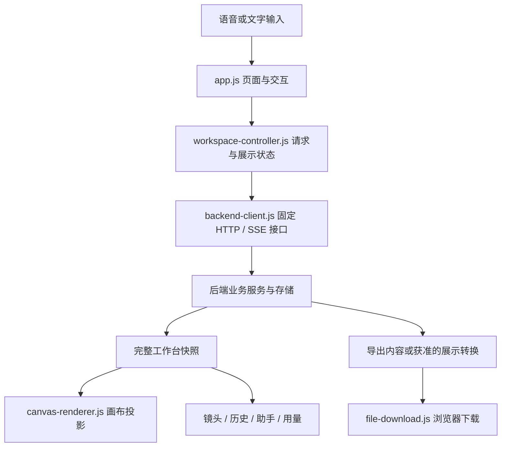
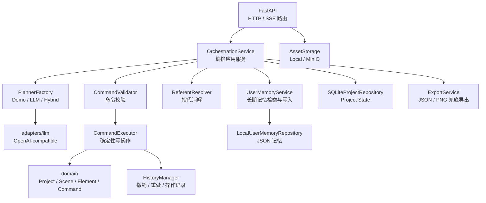
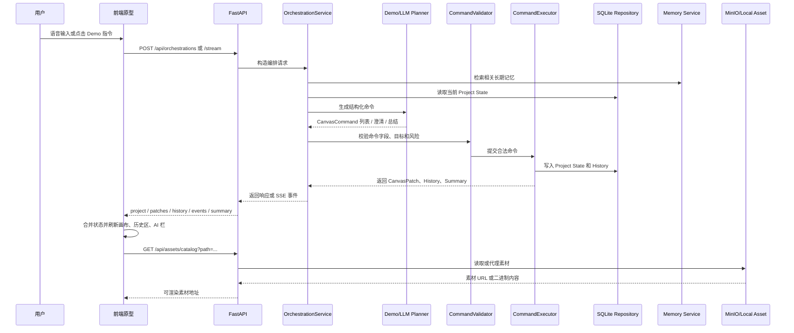

# VoiceCanvas 运行架构

[返回项目首页](../README.md)

## 前端架构

前端只持有后端快照和临时 UI 状态，不执行领域命令、不生成项目数据、不解析澄清候选。
SSE 中间事件用于进度展示，最终画面重新读取后端工作台快照。后端失败时展示错误并
重新读取状态，不用本地演示修改数据，也不自动重放请求。

后端保存项目、撤销重做历史、待澄清任务与用量。语义素材目录属于后端资源，页面通过
`GET /api/render-catalog` 获取展示配置。固定按钮动作与自然语言编排复用同一套
CommandValidator / CommandExecutor，接口见[工作台接口](工作台接口.md)。

## 后端架构

后端核心原则：

- AI 负责理解和规划，系统负责确定性执行。
- 所有画布写操作都经过 `CommandValidator` 和 `CommandExecutor`。
- Project State 是唯一可信状态，前端完整工作台快照只是 UI 展示副本。
- LLM、MinIO、未来七牛云能力都通过 adapter 接入，领域层不依赖外部 SDK。

## 数据完整流转

## 指令能力边界

完整指令验收基线见 [Demo 脚本与指令能力验收](./Demo脚本与指令能力验收.md)，预计实现、已完成、部分完成和未完成原因见 [指令完成情况](./指令完成情况.md)。

当前 README 只保留评审视角的边界：

- MVP 已覆盖创建分镜、镜头切换、文字/商品/标签/箭头添加、内容修改、视觉属性修改、位置调整、删除、澄清、撤销、重做、清空确认、JSON/PNG 导出、未知元素占位、长期记忆基础能力。
- 长图导出属于 P1，当前不作为 MVP 通过条件。
- 任意复杂图像生成质量、PS/Figma 级精细图层编辑、多人协作、无限步 AI 自动规划不在本次 MVP 承诺范围内。
- 普通编辑操作不依赖生图模型；未知对象会先落为结构化占位，保证创作链路不中断。
