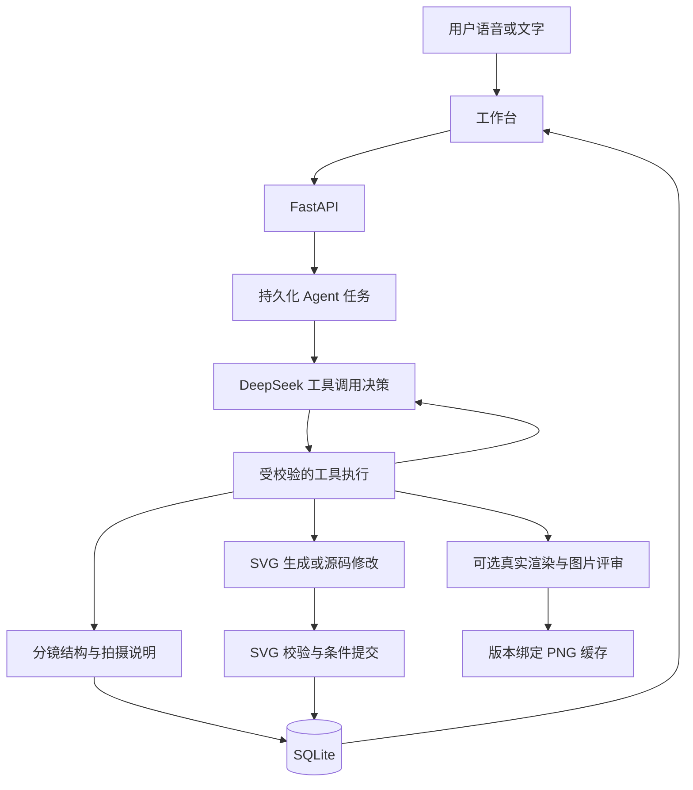

# 架构说明

[项目首页](../README.md) · [接口](API.md) · [测试](TESTING.md)

## 当前产品链路

前端是原生 HTML/CSS/JavaScript 工作台，后端是 FastAPI。自然语言通过模型原生 tools 调用驱动自由 SVG 分镜；模型决定工具与顺序，应用层负责可信执行、预算、版本和持久化。

图中是依赖与结果回传关系，不是固定创作顺序。已有画面可以直接修改，简单管理无需看图，图片评审也可直接调用。管理按钮和直接改字通过确定性 API 完成，不经过模型决策。

## 模块边界

| 层 | 主要文件或目录 | 职责 |
| --- | --- | --- |
| 前端页面 | `frontend/src/prototype/svg-workspace.js` | 交互装配、轮询、预览、语音与导出 |
| 前端客户端 | `storyboard-client.js`、`shot-client.js` | 请求、版本传递、冲突同步及重复提交保护 |
| API | `backend/src/voicecanvas/api/` | HTTP 请求响应与错误映射 |
| 应用 | `application/storyboard_agent_service.py` | 工具执行、预算、任务保存与交付核对 |
| 应用 | `storyboard_service.py`、`shot_service.py`、`shot_visual_service.py` | 分镜、画面、版本绑定预览 |
| 领域 | `domain/` | 分镜与镜头模型、SVG 校验、受限源码和文字编辑 |
| 外部适配 | `adapters/llm/`、`adapters/rendering/` | 模型 HTTP、作画知识加载与 Chromium 渲染 |
| 基础设施 | `infrastructure/` | SQLite、缓存文件和配置组装 |

领域和应用通过生成器、决策、评审、渲染器及仓储协议隔离外部实现，可用替身运行离线测试。绘图知识按 draw/edit 阶段读取随包资源；它不是固定人物或构图模板，来源见[依赖声明](技术选型与依赖声明.md)。

## Agent 的自主性与执行边界

| 工具 | 用途 |
| --- | --- |
| `get_storyboard`、`inspect_shot` | 查询真实状态与源码；源码检查不等于看图 |
| `set_context`、`create_shots`、`describe_shot` | 共用设定、独立拆镜、拍摄说明与时长 |
| `manage_storyboard`、`move_shot_history` | 管理结构和单镜头历史 |
| `draw_shot` | 生成自由 SVG 或提出局部源码替换 |
| `render_shot`、`review_shot` | 可选真实预览和同模型图片评审 |
| `delete_shot` | 记录待确认目标，用户确认后删除 |
| `export_shots` | 请求浏览器下载指定镜头 |
| `finish_task` | 核对真实交付数量、画面和时长，保留未完成项 |

完整参数定义在 `application/storyboard_agent_tools.py`。每任务最多16次决策、40个工具步骤、8次绘图，每镜最多2次绘图；不同镜头最多两路并发绘制，结果逐镜保存。专门图片评审最多4次、每镜2次，相同图和要求复用已有成功结果。预算避免失控调用，不代表必须走完这些步骤。

模型看到当前项目、用户要求和上一任务摘要，自主判断拆镜、生成及修正。代码核对本轮实际创建或绘制的镜头，阻止模型用空交付跳过未画镜头；但数量、时长与合法 SVG 都不能证明语义和画质合格。跨镜人物共用设定目前是文字约束，没有可靠的视觉一致性保证。

## 文档修改与并发

初次生成返回完整 SVG；改画返回最多20处唯一原文替换。所有替换成功、最终 SVG 通过白名单后，才以 `expectedVersion` 条件提交。校验拒绝脚本、事件属性、外链、DTD、嵌入 HTML 与外部图片。前端通过 Blob img 预览，不把模型 SVG 直接作为页面脚本执行。

直接改字由浏览器测量字体与布局，提交文字索引、文本行、字号、行高和基线；服务端重建选中块并再次校验，不接收任意候选 SVG。隐藏测量 iframe 使用 sandbox 和 CSP；用户输入作为文本写入。确定性边界不保证任意复杂 SVG 的视觉排版。

| 状态 | 存储 | 历史与一致性 |
| --- | --- | --- |
| 镜头画面 | `svg_shots` | 最多40个快照；画面版本单调递增，撤销不等于降低版本 |
| 分镜结构 | `svg_storyboards` | 最多100个结构快照；元数据与新增画面同事务提交 |
| Agent 任务 | `svg_agent_runs` | 步骤、用量和状态持久化，同项目禁止重复运行任务 |
| 图片缓存 | 数据库同级 `shot-previews/` | 项目、镜头、版本、源码摘要与渲染器共同确定缓存键 |

画面与结构分别进行版本检查，长模型调用不能覆盖其他页面已保存的修改。删除只移除分镜引用，保留画面以便结构撤销；当前没有项目删除或自动垃圾回收。

任务在单个 Uvicorn 进程的线程池执行，尚未接入独立队列。页面轮询只读取；进程重启标记中断，不重放结果未知的付费请求。当前不支持多 worker 部署。

## 真实预览与评审

渲染器先校验 SVG，再用独立临时 profile 启动已有 Edge/Chromium，输出1280×720 PNG。渲染25秒超时，图片最大8 MB；临时文件随缓存配置放置，不使用用户浏览器配置，不关闭浏览器沙箱。

`render_shot` 的真实 PNG 附在下一次 Agent 决策消息中；Base64 不写入任务数据库。`review_shot` 自带渲染与缓存，把 PNG、拍摄要求和检查重点发送给同一模型，不附 SVG 源码。评审最多列三个可观察偏差和不确定项，无自动重试。

渲染、缓存读取和评审结束时核对版本，旧图不能作为当前图返回。只读预览 GET 不启动浏览器、不请求模型；前端把改画前记录标为历史。模型可能误判，静态图不能证明完整运动过程，真实失败样本见[视觉实测](experiments/shot-visual-tools-20261117/README.md)。
