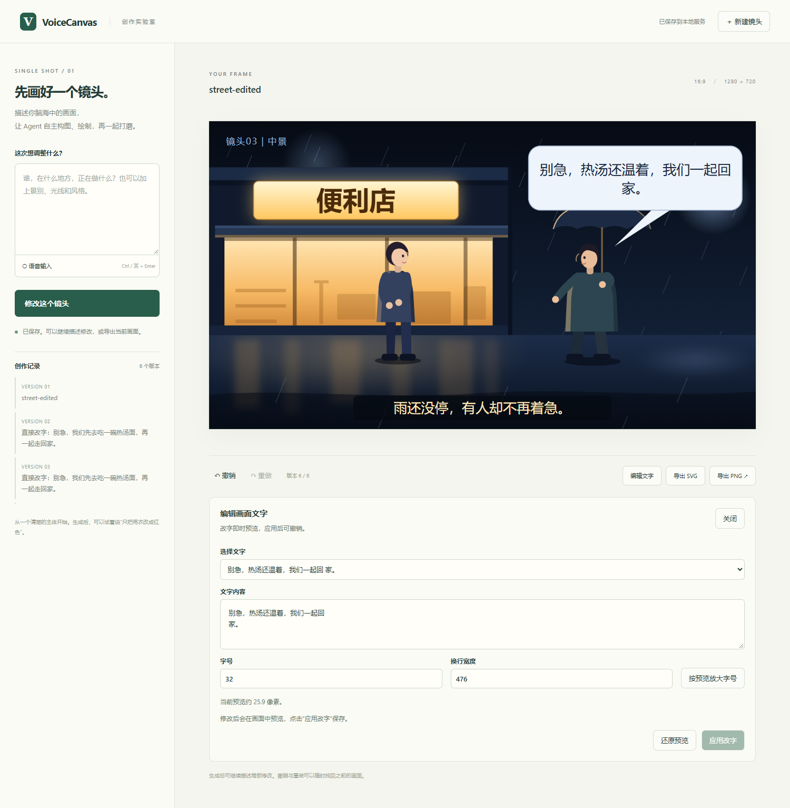
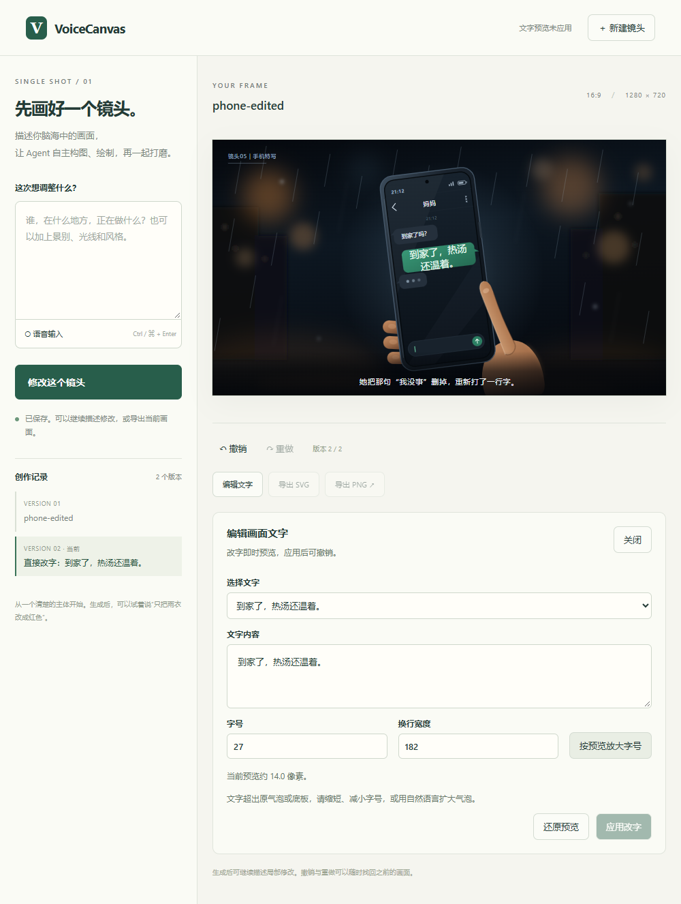

# 直接文字编辑验收（2026-11-17）

本次把分镜文字实测中的“改一句对白需要约 25 秒”推进为确定性编辑：选择已有文字 → 修改内容/字号/换行宽度 → 即时预览 → 保存为一个可撤销版本。原场景和气泡轮廓保留，不调用在线模型，无新增第三方依赖。

## 实际界面





[390px 手机布局](mobile.png)没有横向溢出，字号提示随实际预览宽度更新。手机字号不足时不会强行把文字塞进原气泡；可以缩短内容或先通过自然语言扩大气泡。

## 本机实跑

- 复用上一实验保存的 `street-edited.svg` 和 `phone-edited.svg`，从真实产品 API 获取、修改并保存；不是重抽更好的模型画面。
- 使用独立的临时演示 SQLite 和本机已有 Edge/Playwright，前端为当前静态服务，后端为当前 `voicecanvas.api.main:app`；没有写用户的原产品数据库。
- 两个独立 text 元素组成的对白识别为一个块。浏览器使用实际 SVG 字体测量后自动换行，保存请求只发送文本行与排版参数；服务端自行重建选中文字，不接收整个候选 SVG。
- 字体测量在隐藏 iframe 中完成，sandbox 禁止脚本，CSP 禁止外部资源；额外插入测试脚本未执行。隔离后重新核对保存前后预览像素一致。
- 普通对白和带旋转变换的手机消息，保存前预览与保存后预览的截图像素均一致。
- 点击保存到响应的两个本机样例约为 508ms 与 184ms，含自动化点击耗时，不是性能基准或生产延迟承诺。
- 撤销、重做和刷新恢复正确；SVG 导出含新文案，PNG 导出为 1280×720；修改期间没有向 `/generate` 发请求，也没有调用供应商。
- 两标签页先后修改时，旧版本提交返回 409，页面同步最新文字，不会覆盖另一页或自动重试。
- 手机消息在 1000px 窗口的实际预览中约为 8.1px，会提示偏小；推荐放大后超出矩形底板，应用按钮禁用。390px 视口未发生水平溢出。没有页面运行错误。

详细结果见 `validation.json`。这些是本机功能与完整性验收，不能证明跨系统字体一致、任意 SVG 排版都适用，或整体绘画质量已达标。

## 自动验证

后端（在 `backend`）：

```powershell
python -m pytest tests/test_shot_text_edit.py tests/test_single_shot.py -q
python -m pytest -q
python -m ruff check src/voicecanvas/domain/svg_text.py src/voicecanvas/application/shot_service.py src/voicecanvas/api/shots.py tests/test_shot_text_edit.py
python -m mypy src/voicecanvas/domain/svg_text.py src/voicecanvas/application/shot_service.py src/voicecanvas/api/shots.py
```

前端（在 `frontend`）：

```powershell
npm test
```

实际：后端相关 69 passed，全量 253 passed、1 skipped（真实在线模型 opt-in）；Ruff 和 mypy 通过。前端原型契约通过，16 项单镜头测试通过。现有 Starlette/httpx 弃用警告不影响通过结果。

后端覆盖文字注入作为普通内容、矩形背景/字幕等无关对象保留、旧索引冲突、历史分支、非法字号与行距、混合样式与共享定义拒绝，并回放三个真实模型多行样本。前端覆盖中文标点、英文空格、显式空行、组合字符、变换与预览字号、矩形底板识别以及客户端提交版本。普通背景不会被误当文字底板，改字不将标题移至画面中心。

## 边界

本模块支持普通 text 和同样式 tspan，不强行扁平化特殊字形、共享定义或字符独立定位。矩形底板识别与包围盒碰撞是确定性检查，不能代替视觉评审；不自动检测人物脸部遮挡、不改造任意路径气泡、不提供拖动或自由缩放。浏览器里的字号提示是可读性辅助，较小的角标和声效仍可保留。

使用方式和 API 见 [单镜头创作](../../单镜头创作.md#直接文字编辑)。本项目实现文本块识别、受限编辑、测量/排版和历史闭环；原画来自外部模型，字体渲染来自浏览器。
