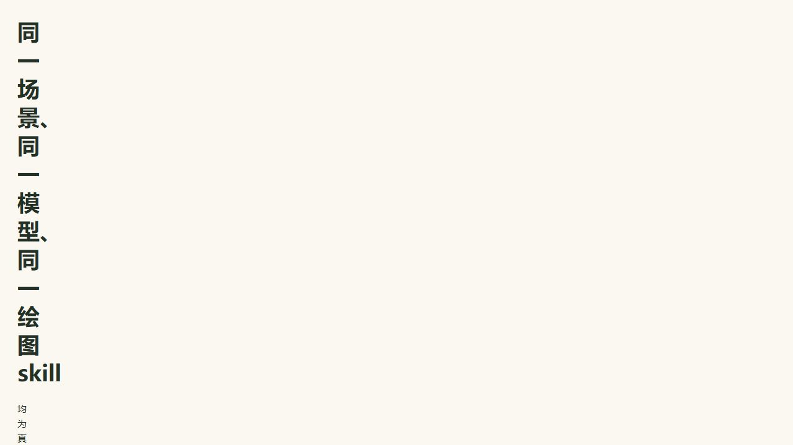

# 绘图提速与真实业务模拟

> 本记录对应旧句式路由版本。后续已用[自主 Agent](../storyboard-agent-20261117/README.md)解决独立拆镜、复合管理及整组下载请求，文中的流程失败保留为当时证据。动作质量仍未稳定达标，当前使用方式以[使用指南](../../使用指南.md)为准。

## 结论

当前供应商实际生效的关闭思考参数是 `reasoning_effort=off`，不是 `thinking.type=disabled`。保持同一模型、完整绘图 skill、提示、24000 字符目标和 32768 token 上限，两次快速生成分别为 16.654、20.763 秒；对照为 123.389 秒。显著缩短了等待，但快速版仍会漏掉动作，本次不能宣布业务体验合格。

这是一位开发者代入店主需求的业务模拟，不是真实客户访谈或用户研究。所有绘图真实调用 `https://api.commandcode.ai/provider/v1` 的 `deepseek/deepseek-v4.1-flash`，页面使用真实产品后端与 SQLite，没有用固定生成器或录制语音代替模型。业务输入通过实际浏览器打字，未验收真人麦克风识别。

## 测速条件与全部结果

统一题目为黄昏车站：黄外套女孩坐长椅、红伞、背景列车、中景暖色手绘、不含文字。temperature=0.4，max_tokens=32768，timeout=300，IPv6 连接，均无自动重试。

| 配置 | 首个绘图内容 | 完整响应 | 思考 token | 校验与效果 |
| --- | ---: | ---: | ---: | --- |
| `thinking.type=disabled` | 107.328s | 123.389s | 16178 | 参数被忽略，合法 SVG，有坐姿 |
| `reasoning_effort=off` | 2.882s | 16.654s | 0 | 合法 SVG，但站姿未满足“坐着” |
| `reasoning_effort=off` 重复 | 3.086s | 20.763s | 0 | 合法 SVG，独立原始产物保留 |
| `reasoning_effort=low` | 98.274s | 116.797s | 12745 | 含不支持的 SVG 属性，未通过校验 |

完整流式响应文本、用量、错误和时长见 [measurements.json](measurements.json)。失败样本一并保存，未删除或自动修复。首个绘图内容是上游文本到达时间，当前 UI 在完整 SVG 校验保存后才显示画面；不能把 2.9 秒说成用户已经看到画面。

同题样本量很小，不能当平均延迟、成功率或画质因果结论。部分样本有供应商输入缓存命中，但仍可由 reasoning_tokens=0 确认思考关闭；没有改变模型名称或偷偷切换模型。匿名 `/models` 约 1.5 秒，主要长等待来自生成和思考。

## 模拟的真实业务

店主需要给摄影师一份 15 秒雨天促销短片的三镜头分镜：0–5 秒雨中女孩走进暖杯咖啡；5–10 秒店员递咖啡；10–15 秒产品特写与促销字幕。要求人物衣着一致，老板临时把“第二杯半价”改成“买一送一”，最后按顺序交付图片。

实际项目 `board_c93c9bd095ae463c`，本机查看：`http://127.0.0.1:4178/workspace.html?board=board_c93c9bd095ae463c`。原项目保持完整。操作与结果如下：

| 用户任务 | 实际结果 | 判断 |
| --- | --- | --- |
| 一次描述完整三个镜头 | 24.535 秒，3 段内容绘在同一个 SVG，后绘背景遮住前面，列表只有 1 镜头；提示成功 | 严重卡点，未实现拆镜头，且没有发现未满足需求 |
| 分开说“新建一个镜头，画外景…” | 25.820 秒，成功创建独立画面并显示暖杯咖啡招牌 | 流程可用；女孩为正面站姿，“走向门口”没有表达好 |
| 单独生成店内递杯 | 保存成功，人物大致衣着相符，人物造型有差异；双方没有握同一杯 | 未满足关键拍摄动作 |
| 自然语言要求双方伸手共同握杯 | 11.550 秒保存新版本，手臂和杯子位置改变，仍没碰到杯子 | 修改接口有效，语义目标失败，不能按“已保存”判断任务完成 |
| 修改促销字幕 | 从文字列表选中字幕，直接编辑为“雨天咖啡买一送一”，预览和保存成功，usage={} | 有效且快速，不需要为改字请求模型 |
| “把第一个镜头移到最后” | 返回“请分开说一条指令” | 常见单条口语也不支持，错误提示不准确 |
| 改说“把第一个镜头移到第三位” | 成功排序为外景→店内→产品 | 有绕行路径，用户必须学习句式 |
| “导出全部分镜给摄影师” | 被命令路由拒绝，导出菜单也只有当前镜头 | 交付卡点，当前只能逐张下载 |
| 刷新与逐张下载 | 三镜头顺序、修改与文字保存成功；逐张导出真实 1280×720 PNG | 基础保存和下载可用 |

时长从浏览器点击时间到后端修订 createdAt 计算，包含产品接口往返，不是纯模型时长。没有记录可靠起点的店内初稿不补造耗时。实际产物与用量见 [business-manifest.json](business-manifest.json)、business-1/2/3.svg。最终三张 PNG 已从产品下载；联系图仅供本文对照，由开发工具拼接，产品目前没有整组导出。

此外窄窗口中“新建并画”会自动展开助手并遮住部分画布；没有时长、景别或摄影机运动的独立说明字段，15 秒分配不能形成可导出的结构化拍摄说明。本次未把这些缺口混入提速实现。

## 本轮判断与建议

直接实施：默认关闭该网关的深度思考，保留输出预算、作画 skill、自由 SVG、校验、版本历史、直接改字；没有删除角色动作要求、改成模板或增加自动付费重试。新配置可在后端改为 `provider-default`，省略该供应商参数，或按支持情况显式指定其他强度。

暂不做：压低 max_tokens（可能截断而整次失败）、删除绘图知识（不是本轮长等待主因）、自动多次重画（可能把快图变成更长的返工）、未测量就换另一个型号。`low` 实测仍慢且失败，暂不能作为折中方案。

业务优先级建议：先让动作需求和修正结果达标，再实现从完整需求拆成可编辑镜头列表、绑定共用角色描述，最后补整组带说明交付。照片级插画、自动视频、复杂动画、偏好记忆可以后排；不建议为了速度删掉拍摄动作或必要字幕。

需要产品判断的是交付标准：若定位拍摄沟通草图，允许简化背景和细节，但关键动作仍应画对；若要求接近成片美术，当前文本 SVG 生成器无论快慢都没有足够证据达标，需要单独验证更合适的绘图能力。本轮已经提供具体失败产物，供判断这一边界。

## 复现与回归

真实模型验收会消耗供应商额度。正常启动产品，在后端 `.env` 设置 `VOICECANVAS_SHOT_REASONING_EFFORT=off`，重启后新建镜头并使用上述描述；改为 `provider-default` 后重启可比较原供应商策略。保留模型、skill、提示和预算一致，每次新建空镜头；不要在已有画面上把改画当初稿测速。记录完整响应及实际画面，不只记录 HTTP 200。

离线回归：在 backend 运行 `python -m pytest tests/test_single_shot.py tests/test_drawing_skills.py -q`（67 passed），`python -m ruff check src/voicecanvas/adapters/llm/svg_shot.py src/voicecanvas/infrastructure/shot_factory.py tests/test_single_shot.py` 通过。测试覆盖生成/编辑参数传递、不支持配置的启动校验、provider-default 省略参数、保持一次调用和原 SVG 解析协议。测试不访问外部模型。
