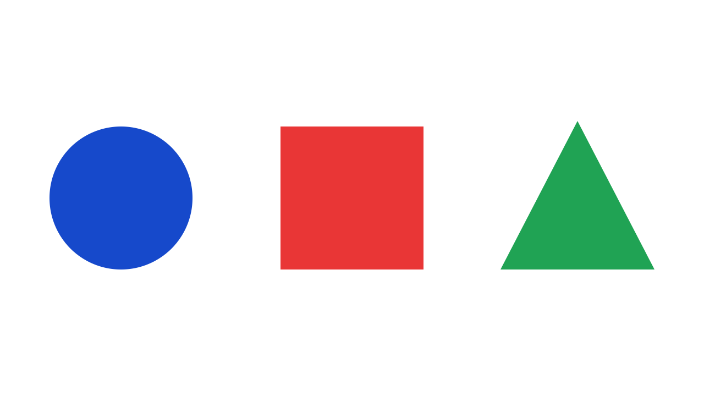
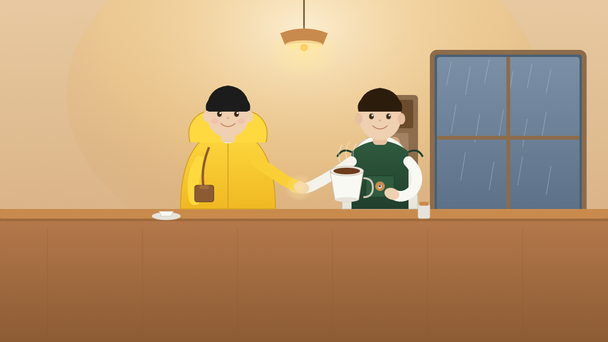
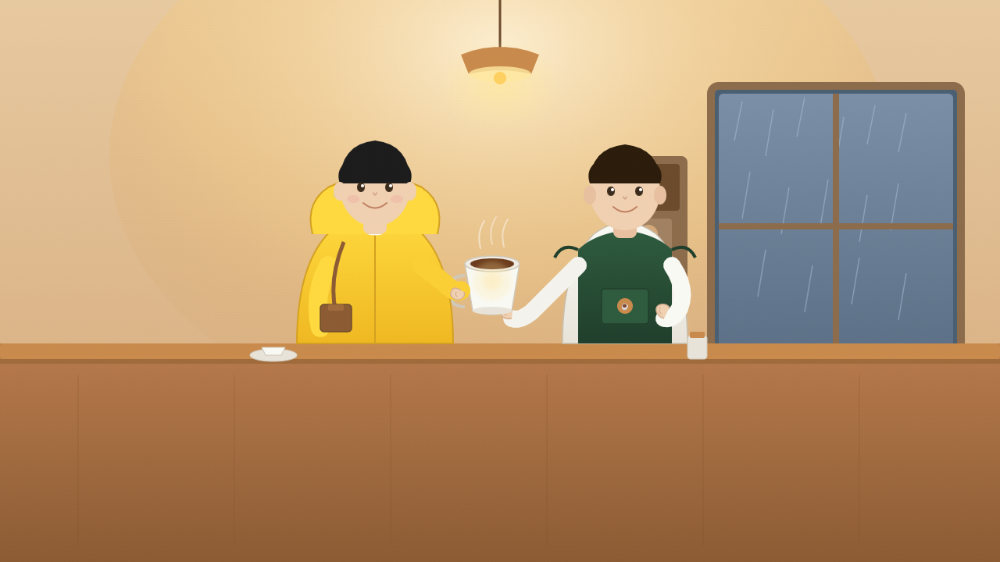
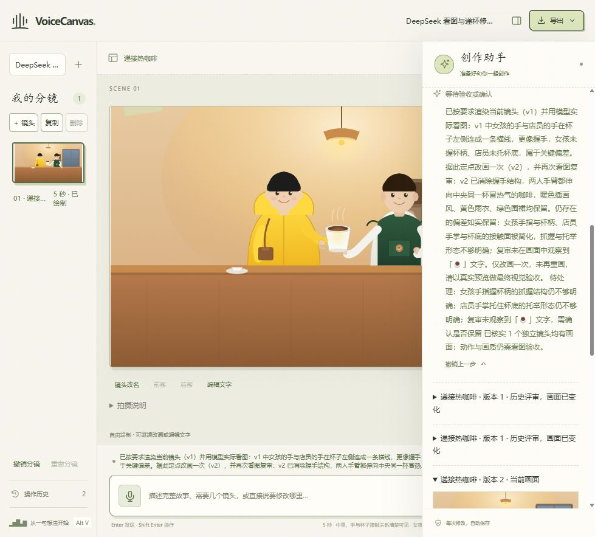

# 同模型镜头视觉工具实测（2026-11-17）

## 结论

当前网关的 `deepseek/deepseek-v4.1-flash` 可以接收真实 PNG，并在本次测试中识别颜色、形状和递杯动作的主要偏差。工具闭环已经跑通，但一次修正没有达到动作要求，整体画质没有稳定改善。不能把工具调用成功当作画质提升成功。

Agent 决策、SVG 创作和图片评审全部使用这个模型与原有端点，`reasoning_effort=off`；没有其他视觉模型、图片生成服务或固定构图模板。

## 独立图片识别

输入是左蓝圆、中红方、右绿三角的实际 PNG，未提供 SVG。第一次直接问图形，模型答“蓝色圆形、红色正方形、绿色三角形。”，用量为输入619、输出9、合计628 token。

随后故意把要求写成“左红三角、中蓝圆、右绿方”，评审指出三个位置的实际图形均与要求不同。完整评审见 [blind-review.txt](blind-review.txt)。这支持当前服务确实处理图片；它不代表复杂人体动作也可靠。



## 递杯镜头实际运行

在独立测试项目复制已有失败镜头，保留原项目。用户要求女孩从店员手里接同一杯咖啡：女孩握杯柄、店员托杯底，保留暖色插画、服装和文字；最多改画一次。

本次请求明确要求先看图再改画，Agent 实际选择 `render_shot → review_shot → draw_shot → review_shot → finish_task`。应用层只执行模型工具调用；这个顺序不是产品内置工作流。其他离线用例验证可以直接 `review_shot`，无需先调用 render。

第一次评审指出：双手在杯子左侧相连，像握手；女孩没有握杯柄，店员没有托住杯底。改画后复审仍指出抓握和托举结构不清，并报告未观察到「☕」文字。模型将任务保留为 `needs_input`，列出未完成项，没有再反复重画。

| 原始版本 v1 | 修正版本 v2 |
| --- | --- |
|  |  |

人工复核：握手结构被移除，但女孩的手仍浮在杯柄旁，店员手部被简化，手臂形态生硬。修正图并未清楚表达接杯动作，整体也不能判为更好。模型评审有诊断价值，修图能力仍是瓶颈；下一轮应验证如何把具体接触关系落实到局部几何修改，而非增加无上限的评审重画。

完整工具参数、返回、原始评审与用量见 [agent-run.json](agent-run.json)。本轮决策及专门评审合计24876 token（输入23246，输出1630）；一次改画8894 token（输入6791，输出2103），另存于 `board.activeShot.revisions[].usage`。本轮合计33770 token，不含复制前的初稿创作和独立盲测。记录没有分步计时，不能据此声称具体提速比例；当前代码已为后续工具结果增加 `elapsedSeconds`。

## 复现和测试

按 [镜头视觉工具](../../镜头视觉工具.md) 配置现有模型与本机 Chromium/Edge。建立独立镜头后输入：

> 先渲染当前镜头并看图评审，检查女孩握杯柄、店员托杯底的接触关系。若有关键偏差，修正一次并复审；最多改画一次，不能修好的问题如实保留。

运行具有随机性，不保证重现相同 SVG 或改善。保存的 `before.svg`、`after.svg` 和两个 PNG 是本次真实结果；浏览器与字体变化可能影响重新渲染的像素。

```powershell
cd backend
python -m pytest tests/test_shot_visual_tools.py tests/test_storyboard_agent.py -q
python -m ruff check src tests/test_shot_visual_tools.py
cd ../frontend
npm test
```

离线测试覆盖真实 PNG 消息格式、缓存和版本冲突、预算及失败、前端历史记录；这些测试只证明协议和边界正确，不证明审美或动作质量。

本次验证：后端全量300通过、1跳过；最后补充读取期间版本冲突检查后，相关回归27通过、Ruff通过；前端契约、7项首页测试和25项镜头测试通过。浏览器在默认8000 API上验证当前 PNG 实际加载为1280×720，v1记录标历史，刷新后可重新展开v2预览与原始评审，未重新提交模型任务。


