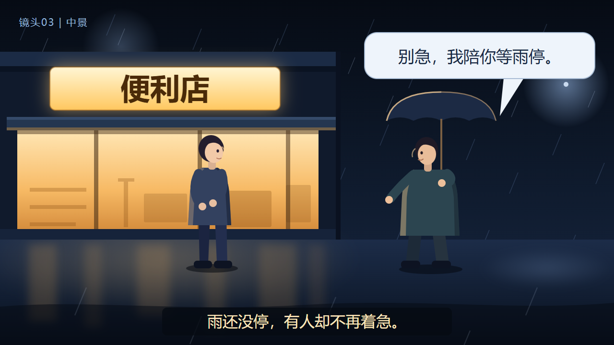
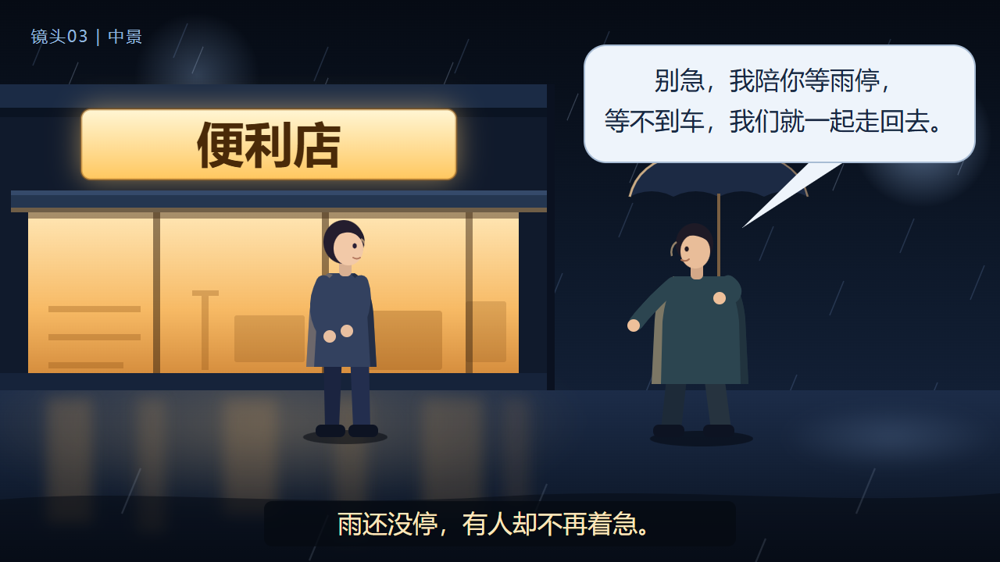
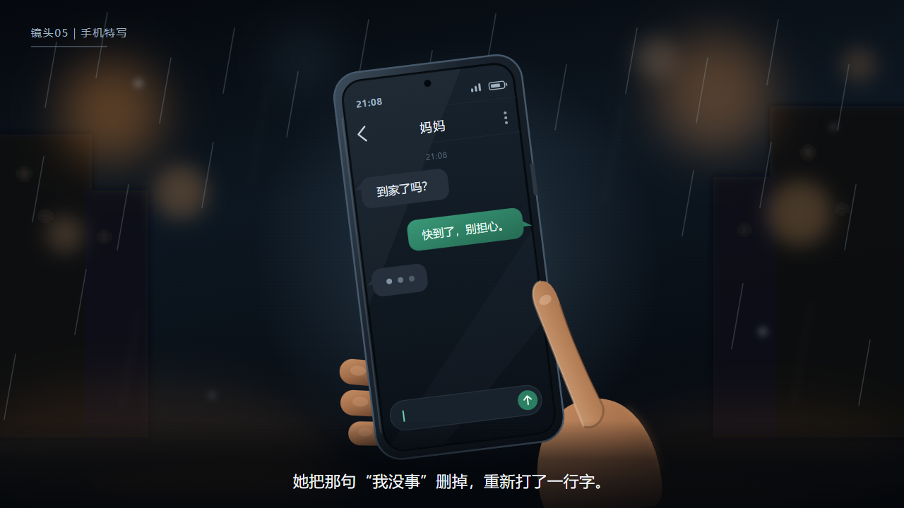
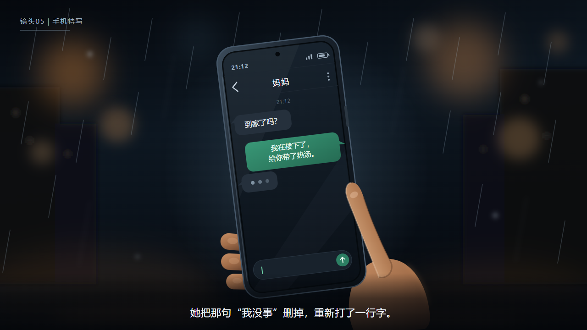
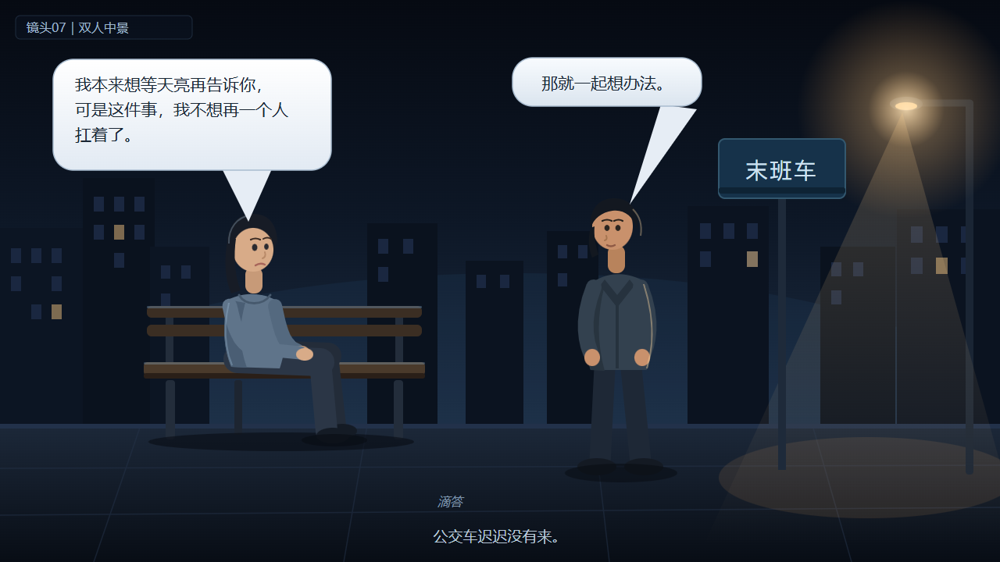
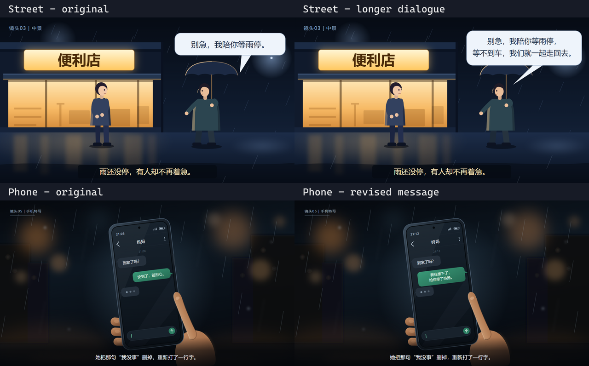

# 正常分镜内文字实测（2026-11-17）

判断：招牌、对白、字幕和手机消息已经能支持普通分镜草稿表达。本次三个初稿及两次改字均完整交付，26 项文案包含检查通过，改长后能调整气泡和换行。仍不能当作稳定的成品排版系统：关键手机消息偏小，镜头间字号不一致，改一句文字仍需约 25–27 秒。

本次按用户澄清，只测正常叙事分镜，没有测试活动海报、长文通知或流程图。人物造型质量与文字排版分别判断；文字可用不意味着整个项目的绘画质量已经达标。

## 全部样本

### 雨夜街头：招牌、对白与字幕





指定文字为招牌“便利店”、朋友对白“别急，我陪你等雨停。”、底部字幕“雨还没停，有人却不再着急。”和“镜头03｜中景”。四项都保留，正文 34px、字幕 32px，明暗对比清楚，气泡位于人物脸部上方。初稿气泡尾部朝向朋友的大致区域，落点不够贴近人物；改长后重新画尾部，指向更明确。

把对白改成“别急，我陪你等雨停，等不到车，我们就一起走回去。”后，模型将气泡从 480×96 扩展为 500×150，正文从 34px 调为 32px，分为两行。未遮挡脸，气泡占据更多上方空间，覆盖了一部分雨伞上方轮廓。人物、店铺和字幕分组逐字未变；实际像素变化只在 `[747,57,502,235]`。

### 手机特写：屏幕文字与数字





指定联系人“妈妈”、时间“21:08”、收到的消息“到家了吗？”、发出的消息“快到了，别担心。”、底部字幕“她把那句“我没事”删掉，重新打了一行字。”和镜头标识。六项保留，收发方向明确，字幕没有压住手机。

将发出的消息改成“我在楼下了，给你带了热汤。”、时间改成“21:12”后，模型扩大消息气泡并分两行，状态栏和聊天时间两处都更新，旧消息和旧时间均已移除。收到的消息、手、镜头标识等语义分组不变，实际像素变化只在 `[525,139,228,236]`。`phone` 祖先分组发生变化，是其内部时间和消息被修改，不代表重画手机机身。

问题在阅读尺寸：消息正文 15.5–16px，联系人 17px，两个时间为 11px 和 12.5px，字幕 22px。1280×720 原图放大后可辨认，缩到 640px 宽分镜预览时，消息正文仅相当于约 8px，难以轻松阅读。这一镜头应进一步扩大屏幕在画面中的占比或提高关键文字字号；本次没有为了得到更好样本追加重抽。

### 双人对白：长句、说话人指向与声效



女人的长对白“我本来想等天亮再告诉你，可是这件事，我不想再一个人扛着了。”分为三行，男人对白“那就一起想办法。”单独成泡，尾部分别指向两人。站牌“末班车”、字幕“公交车迟迟没有来。”、镜头标识和声效“滴答”均保留；未见气泡互相覆盖或遮住脸。

对白为 21px、字幕为 19px，原图能阅读，但相较街头镜头的 32–34px 明显偏小；没有统一的阅读规范。站牌与声效完成了基本信息表达，不能把本次简洁字形等同于已经支持手写、书法或复杂艺术字。

## 调用与验收

| 样本 | 耗时（秒） | 总 token（含推理） | 文案检查 | 实际判断 |
| --- | ---: | ---: | --- | --- |
| 街头初稿 | 128.18 | 20,585 | 4/4 | 基本可用，气泡尾部可更精确 |
| 手机初稿 | 136.66 | 22,244 | 6/6 | 内容正确，消息字号偏小 |
| 公交站初稿 | 143.41 | 24,234 | 6/6 | 长句和说话人关系清楚，字号偏小 |
| 街头改长对白 | 26.74 | 9,473 | 4/4 | 气泡重排成功，无关分组保留 |
| 手机改消息及时间 | 25.35 | 9,887 | 6/6 | 重排成功，两处时间同步更新 |

五次在线调用合计 460.34 秒、86,423 token；因最多两个并发，实验墙钟时间约 316.84 秒。每场景只抽一次，没有删掉失败样本或重试。所有响应 `finish_reason=stop`，三次生成及两次编辑均通过产品适配器。未取得可靠单价，不估算费用；样本量小，不能用 5/5 外推稳定成功率。



这张对照图也展示了常见预览尺寸下的差别：上方街头对白仍容易阅读，下方手机消息明显更小。独立的 `phone-640.png`、`phone-edited-640.png` 和 `dialogue-640.png` 保留同尺寸图片。

文案检查忽略 XML 缩进、换行与空白，保留中文、数字、引号和其他标点，检查指定串按顺序连续出现；它不是 OCR，也不能证明每个文字像素都可见。人工另看了全部五张 Edge 实际渲染图，未见缺字方框或乱码，普通中文在当前系统上可辨认。浏览器 `getBBox` 与坐标变换检查显示所有文字均在画布内，但此检查不能自动排除气泡内部溢出、物体遮挡、对比度不足等问题。

## 条件与边界

- 模型与端点：`https://api.commandcode.ai/provider/v1` 的 `deepseek/deepseek-v4.1-flash`；响应同名，未核实供应商内部路由。
- 请求从当前 `OpenAICompatibleShotGenerator.generate` 捕获，沿用 `temperature=0.4`、最大输出 32768、300 秒超时和默认 `svg-illustration` skill，没有为实验换成单独的排版系统提示。具体任务和必需文案保存在 `cases.json`。
- 生成阶段传入描述，编辑阶段传入现有 SVG 与修改指令。未提供人物模板、固定气泡坐标、字体文件或图片参考；没有把渲染图反馈给模型。
- 在线传输通过独立研究脚本的 Node 原生 fetch 完成，保留项目实际请求体；不是通过产品 HTTP API 端到端发起。真实响应随后经产品适配器、ShotService 与临时 SQLite 完整回放，验证协议和保存链路。
- SVG 文字保持为 text 元素，可通过现有自然语言编辑流程修改，未转换为路径；这不意味着 UI 已有文字框直接编辑、拖动、字号面板或自动排版引擎。
- 使用现有 Edge/Playwright 渲染和测量，sharp 仅用于像素差异统计。没有下载安装新依赖，也未改产品代码或数据库。
- 字体使用 SVG 声明的本地字体回退链；当前 Windows/Edge 通过，不保证 macOS、Linux、缺少中文字体或导入设计软件后的排版一致性。未验证动态改画幅、自动批量镜头、长篇字幕、竖排、复杂艺术字与多语种排版。
- 没有做统一字号或最小阅读尺寸的产品约束，也没有证明 skill 本身带来提升；本次没有关闭 skill 的对照组。

## 留档与离线验证

`*-request.json` 是真实无鉴权请求；`*-response.txt` 是最终输出，不保存内部推理；`*-call.json` 记录实际用量和耗时；`*-layout.json` 保存文本与测量；`results.json` 为流程状态；`pixel-diff.json` 为改字前后实际像素差异。每张图保留原始 SVG 和 PNG。`sha256.json` 校验其他所有留档文件，目录级 Git 属性防止换行转换破坏原始字节。

在配置好项目 Python 环境后，从 `backend` 执行：

```powershell
python -m pytest tests/test_storyboard_text_replay.py -q
```

这些测试不访问网络、不消费额度、不改留档或产品数据库。它们通过 httpx MockTransport 回放五个真实响应，执行产品响应解析、SVG 校验、ShotService、临时 SQLite 重载与两组撤销重做；检查全部 26 项指定文案、修改后旧文案移除，以及语义分组保留情况。研究脚本的详细回放结果另保存在 `validation.json`，同一批验证已整理为上述三个参数化测试。

既有协议测试命令（`backend`）：

```powershell
python -m pytest tests/test_single_shot.py tests/test_drawing_skills.py tests/test_storyboard_text_replay.py -q
```

本次实际 64 passed（一个现有 Starlette/httpx 弃用警告），其中新增三个真实样本回放用例。新增测试通过 Ruff 检查；测试验证内容与流程，不代表对审美或跨系统字形作出保证。

如需在线复放，可从 `*-request.json` 读取 payload，以当前进程环境变量提供 Authorization 后 POST 到上述端点；会消耗在线 API 额度。编辑请求使用的是本次实际初稿，不可假定新生成的初稿仍能匹配留档补丁。

## 产品判断

如果用户要的是“用文字辅助表达剧情的可编辑分镜草稿”，本次基本达到；如果要求一组镜头在常见预览尺寸上都清楚、字号统一，并能快速反复改对白，当前只达到部分要求。

下一步值得做的是统一关键对白和屏幕文字的阅读尺寸，并为已有文字提供直接编辑与确定性换行能力。模型继续负责自由构图和气泡位置，通用文本测量负责防止溢出；这不需要预设人物或固定画面模板。本次仅提供判断与验证记录，未实施这些功能。

外部模型负责具体绘制和补丁，第三方浏览器负责文字与图形栅格化；本项目负责协议、校验、持久化、编辑闭环和实验验证，不将模型与字体引擎能力表述为原创。
