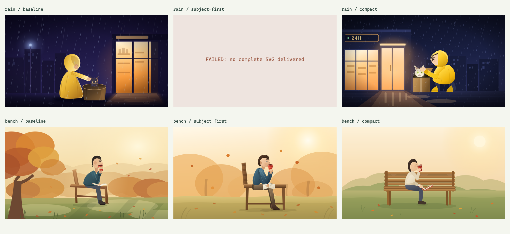

# 人物与动作质量提示对照（2026-11-17）

结论：将简短的主体、动作、面部与接触关系优先级加入初次绘制提示。它在本次两个场景中均完整出图，雨夜主体比现有提示更可读；膝踝连接仍不自然，尚不能证明稳定提升。长关节清单在雨夜样本中耗尽输出预算，不接入默认流程。

## 实验设置

- 同一服务与模型：`https://api.commandcode.ai/provider/v1` 上的 `deepseek/deepseek-v4.1-flash`，身份按服务商响应记录。
- 两个场景：雨夜便利店、女孩蹲下抚摸箱中小猫；秋日公园、人物坐长椅看书举杯。每个场景同一段描述，不增加姿势坐标或预绘素材。
- A：原有单次 SVG 提示。B：追加详细的关节、重心与遮挡清单。C：追加四句短提示，强调主体轮廓、动作、面部、接触点，减少环境装饰。
- 各样本 `temperature=0.4`、`max_tokens=32768`、超时 300 秒、1280×720，最多两个并发请求。每个条件仅一次，无自动重试。
- 最初固定 A/B 四次调用。看到雨夜 B 截断后，再登记 C 的两个补充样本；C 是自适应探索，不是预先固定的独立验证集。保留 B 失败，不补抽替代。
- 评判条件提前确定：姿态能否辨认、肢体连接、面部朝向与表情、接触点、整体构图，以及是否交付完整 SVG。下面的视觉判断由人工审阅，没有盲评或独立评分员，也没有统计显著性结论。

## 全部结果



每行依次为 A 原提示、B 详细结构提示、C 短主体提示。点击原始 SVG 可用浏览器放大查看：

| 样本 | 完整交付 | 耗时 | 总 token（含推理） | 原始 SVG |
| --- | --- | ---: | ---: | --- |
| 雨夜 A | 是 | 126.91 秒 | 20,435 | [原提示](rain-baseline.svg) |
| 雨夜 B | 否，输出预算耗尽 | 200.64 秒 | 未返回，不按零计费 | 无完整产物 |
| 雨夜 C | 是 | 177.01 秒 | 28,362 | [短提示](rain-compact.svg) |
| 长椅 A | 是 | 200.34 秒 | 32,582 | [原提示](bench-baseline.svg) |
| 长椅 B | 是 | 155.02 秒 | 24,759 | [详细提示](bench-subject-first.svg) |
| 长椅 C | 是 | 163.62 秒 | 22,480 | [短提示](bench-compact.svg) |

雨夜 A 的环境有空间和冷暖光，但人物轮廓接近站立长袍，未清楚表达蹲姿，猫也接近未填充的轮廓。C 的人物有可辨认的侧脸和弯曲腿部，猫的头部及触碰关系更清楚；仍有腿部连接、膝踝方向不自然的问题。C 在这一场景比 A 多约 50 秒、7,927 token，不能声称画质改善免费或更快。

长椅 A 已能表达坐姿、书和杯；B 的手臂、面部与书本更清晰；C 减少了背景装饰，主体动作仍可读，整体更简洁。不同样本均有近远侧腿部重叠、风格与比例问题，没有一种提示全面解决人物造型。

本次 A 与 C 各 2/2 完成，B 为 1/2；不能把这么小的样本当作可靠成功率估计。未固定可验证的随机种子，构图与细节存在随机波动，无法将所有差异归因于提示。更长提示与截断之间也不能凭这一个失败样本建立因果关系。

## 采用的改动

初次生成的系统提示仅增加下面四句，与本次 C 请求逐字一致：

> 先把主体画好，再画环境：动作要从轮廓上读得出来，肢体与接触点要连贯，面部要有清楚的朝向和表情。
> 人物的服装跟随身体姿态，不能靠长袍或裁切省略用户要求的动作。
> 可以减少背景装饰，把绘图细节集中在主体；以清晰、有表现力的叙事插画为目标，按用户风格执行。
> 不逐项演算解剖，直接用简洁、完整的 SVG 表达画面。

没有增加调用阶段、人物模板或图元目录。局部编辑协议、输出预算和 SVG 白名单沿用单镜头模块。外部模型仍负责具体构图与绘制；这些插画为模型产物，本项目原创部分是提示协议、对照与审阅记录。

## 复现与验证

`requests.json` 保存六个完整、无鉴权信息的实际请求，`results.json` 保存所有状态、用量与耗时。SVG 为领域校验后产物，入库文档时仅清理纯空白行的行尾空格，文字节点和绘图属性保持原样；`svg_chars` 记录清理前长度。失败时原适配器不返回 partial SVG 和 usage，因此雨夜 B 没有可检查的半成品或确切 token 用量。模型输出具有随机性，复现请求不会得到逐像素一致的图片。

在 PowerShell 中选择一个请求发送（会消费在线 API 额度，不属于自动测试）：

```powershell
$samples = Get-Content -Raw -Encoding utf8 docs/experiments/subject-quality-20261117/requests.json | ConvertFrom-Json
$payload = ($samples | Where-Object name -eq 'rain-compact').request | ConvertTo-Json -Depth 10
# 先在本进程设置 VOICECANVAS_EXPERIMENT_API_KEY，勿把密钥写入仓库。
$headers = @{ Authorization = "Bearer $env:VOICECANVAS_EXPERIMENT_API_KEY" }
Invoke-WebRequest -Uri 'https://api.commandcode.ai/provider/v1/chat/completions' -Method Post -Headers $headers -ContentType 'application/json; charset=utf-8' -Body ([Text.Encoding]::UTF8.GetBytes($payload)) -TimeoutSec 300 -OutFile response.sse
```

`response.sse` 中 `delta.content` 为 SVG 文本片段；须确认 `finish_reason=stop` 后拼接，并通过单镜头 SVG 校验再使用。可以直接在浏览器中打开已保存的原始 SVG 检查本次产物。比较图使用本机 Edge 统一栅格化，并通过本机已有 sharp 合成；这些依赖仅是实验渲染工具，无新增产品依赖。

离线回归命令：在 `backend` 运行 `python -m pytest tests/test_single_shot.py -q`，验证生成/修改适配器、截断处理和可信状态。本次实跑 48 passed，其中新增五个真实 SVG 的响应回放用例，验证复杂路径、分组、滤镜和文字经过流式适配、SQLite 重载、撤销和重做后逐字保留。测试使用可控替身，不能证明审美质量；真实图片与局限见上表。复原 A 提示即可撤销这项提示调整。
