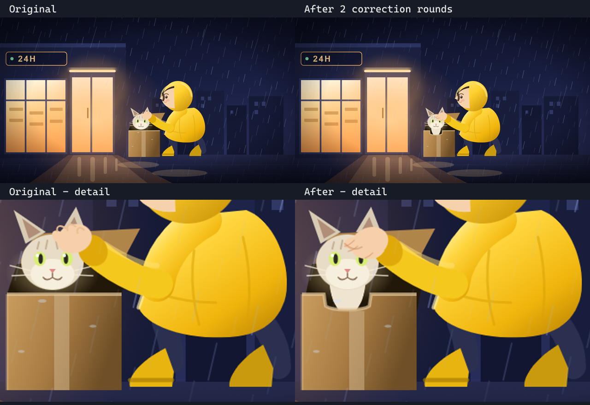

# 单镜头视觉反馈实测（2026-11-17）

本次真实跑通了 SVG 渲染、图片评审、局部放大、源码补丁和候选比较。两轮后手部轮廓略有改善，人物蹲姿和腿部连接没有解决；模型对原图还提出了不准确的诊断。暂不将此循环接入产品自动提交。

## 画面与结论



- [初始 SVG](initial.svg)：复用此前短主体提示实验的雨夜镜头，没有重新抽取初稿。
- [第一轮 SVG](candidate-1.svg)：补猫颈部，将箱体前沿改成凹口，略移手掌。
- [第二轮 SVG](candidate-2.svg)：改手掌轮廓和指缝，沿用第一轮箱体改动。
- [模型最终保留版本](retained.svg)：第二轮候选，代表模型选择，不代表通过独立质量验收。

人工对照判断：第二轮的手掌比原图圆团更像朝猫头伸出的手。纸箱凹口改变了容纳关系，但是否更自然存疑；原图其实已有暗色箱口，并非模型描述的完全封闭箱体。原图手与猫头已有重叠，模型所说的明确空隙也不成立。人物下半身的连接与蹲姿才是明显的主体问题，模型虽然在“不确定”中提及姿态，却没有把它列为修正目标。

因此，这次有依据的结论是：工具链能够执行修改，局部手形有小幅收益；当前自审的事实判断和问题优先级不够可靠。不能由一次样本断言模型没有视觉能力，也不能据此宣称自动修图稳定有效。它没有解决用户希望的整体绘画质量问题。

## 实验条件

- 端点 `https://api.commandcode.ai/provider/v1`，请求及响应模型均为 `deepseek/deepseek-v4.1-flash`，未独立核实供应商内部路由。
- 描述：雨夜便利店门口，一个穿黄色雨衣的女孩蹲在纸箱前，伸手轻抚箱中小猫。中景，人物与小猫是视觉中心，暖光从门内照出，与蓝紫色雨夜形成对比；有连贯的空间、动作和遮挡，简洁电影感插画。
- 1280×720；`temperature=0.2`；串行调用，每次超时 300 秒，无自动重试。初评和比较最大输出 12000 token，补丁最大输出 32768 token。
- 第一次评审只接收用户描述与实际 PNG，不接收 SVG 源码或人工问题清单，最多提出两个问题及像素区域。
- 修图接收当前 SVG、整图、评审区域各扩边 20 像素后的 2 倍放大图（最大宽 1200）。补丁逐字唯一匹配，经过现有 `apply_source_edits` 原子应用与 SVG 白名单校验后再渲染。
- 比较接收当前保留图 A 与候选 B，要求改善不明确时保留 A；仍由同一个模型负责，并非独立评审，也未做 A/B 顺序随机化。模型两次都选择 B，人工不完全认同其判断。
- 达到两轮上限即停止；模型仍列有剩余问题，不将停止标成“画好”。所有改动只发生在实验文件，未写产品数据库。
- 本次不加载前一 PR 的作画 skill，而使用本目录中针对实际图像评审与修复的请求提示。初稿来自更早的短主体提示实验，不是 skill 配置的生成结果，不能将本次结果当作 skill 有效性验证。

## 调用与成本

| 调用 | 耗时（秒） | 输入 token | 输出 token（含推理） | 总 token | 结果 |
| --- | ---: | ---: | ---: | ---: | --- |
| 初次纯图片评审 | 42.26 | 824 | 4,410 | 5,234 | 返回两个问题，事实描述部分不准确 |
| 第一轮修图 | 90.29 | 7,992 | 14,386 | 22,378 | 补丁通过校验并渲染 |
| 第一轮比较 | 31.82 | 1,645 | 3,864 | 5,509 | 模型选 B，继续修手 |
| 第二轮修图 | 77.23 | 7,829 | 11,759 | 19,588 | 补丁通过校验并渲染 |
| 第二轮比较 | 19.02 | 1,502 | 2,210 | 3,712 | 模型选 B，仍有手部问题 |
| 合计 | 260.62 | 19,792 | 36,629 | 56,421 | 两轮上限停止 |

耗时是在线请求时长之和，不含本地渲染、裁切和人工审阅；初稿生成费用也不计入。没有可靠单价，不换算金额。供应商 usage 中的 `image_tokens=0` 不能用来断言未处理图片，计数方式未知。所有调用 `finish_reason=stop`，没有截断或失败重抽。

## 留档与复现

`*-request.json` 保存实际请求，图片 data URL 统一替换为 `[local rendered PNG]`，未保存密钥。`image-manifest.json` 按消息内容出现顺序列出每个请求对应的实际图片，包含两轮放大图；`*-call.json` 保存实际用量和耗时；`review-0.json`、`candidate-*.json`、`verdict-*.json` 保存模型最终可见输出。未保存推理内容。`results.json` 汇总流程状态，`validation.json` 保存离线源码校验与像素差异检查，`sha256.json` 校验所有其他留档文件。

无需模型或新增依赖即可在浏览器打开三个 SVG 对照。以下命令从 `backend` 执行，验证留档补丁可以通过现有领域函数逐字复原两个候选：

```powershell
python -c "import json; from pathlib import Path; from voicecanvas.domain.svg_document import validate_svg,apply_source_edits; p=Path('../docs/experiments/visual-review-20261117'); s=validate_svg((p/'initial.svg').read_text(encoding='utf-8')); [(validate_svg((p/f'{n}.svg').read_text(encoding='utf-8'))) for n in ['candidate-1','candidate-2','retained']]; s1=apply_source_edits(s,json.loads((p/'candidate-1.json').read_text(encoding='utf-8'))['edits']); assert s1==(p/'candidate-1.svg').read_text(encoding='utf-8'); s2=apply_source_edits(s1,json.loads((p/'candidate-2.json').read_text(encoding='utf-8'))['edits']); assert s2==(p/'candidate-2.svg').read_text(encoding='utf-8'); assert s2==(p/'retained.svg').read_text(encoding='utf-8'); print('4 SVG validated; 2 patch batches replayed exactly')"
python -m pytest tests/test_single_shot.py tests/test_drawing_skills.py -q
```

如未安装包，先设置 `PYTHONPATH=src`。上述检查验证源码完整性和既有流程，不验证画面美观程度。

本次实际验证：4 个 SVG 通过白名单校验、2 组补丁逐字复原成功；相关回归测试 61 passed（一个现有 Starlette/httpx 弃用警告）。最终图与原图差异共 2,797 像素，差异包围框为 `[558,408,148,154]`，范围未触及腿部，见 `validation.json`。

需要再次发在线请求时，可在仓库根目录用以下标准库脚本重建任意单次请求；会消耗外部 API 额度。密钥只从当前进程环境读取，不写入请求文件：

```python
import base64
import json
import os
from pathlib import Path
from urllib.request import Request, urlopen

p = Path('docs/experiments/visual-review-20261117')
label = 'review-0'  # 可切换 candidate-1 / verdict-1 / candidate-2 / verdict-2
payload = json.loads((p / f'{label}-request.json').read_text(encoding='utf-8'))
images = iter(json.loads((p / 'image-manifest.json').read_text())[label])
for part in payload['messages'][1]['content']:
    if part['type'] == 'image_url':
        png = (p / next(images)).read_bytes()
        part['image_url']['url'] = 'data:image/png;base64,' + base64.b64encode(png).decode()
req = Request(
    'https://api.commandcode.ai/provider/v1/chat/completions',
    data=json.dumps(payload, ensure_ascii=False).encode('utf-8'),
    headers={
        'Authorization': 'Bearer ' + os.environ['VOICECANVAS_EXPERIMENT_API_KEY'],
        'Content-Type': 'application/json',
    },
)
with urlopen(req, timeout=300) as response:
    Path(f'{label}-replay.sse').write_bytes(response.read())
```

此示例复放某个请求的实际输入，不自动串联新输出，不能假定新输出仍适配旧补丁。完整循环的运行器本次保留在工作区研究目录，尚未实现可部署的产品适配器。模型输出具有随机性，复现不保证与留档相同。

## 后续方向与能力边界

渲染、裁切、放大已经能提供，不需要再寻找大量绘图插件。下一次值得检验的是：换用能可靠检查图像细节的独立评审模型，或先由人工明确“修正蹲姿与腿部连接”，看写 SVG 的模型能否针对正确目标修好。当前实验尚未验证这两种做法。

图像渲染使用已有 Edge 与 Playwright，放大和比较图使用已有 sharp；它们只负责确定性图像处理，无新增产品依赖。外部模型提供视觉文字与绘图补丁；本项目原创部分是受限反馈流程、补丁验证及实验留档，不将模型绘图能力或第三方渲染器宣称为原创。
