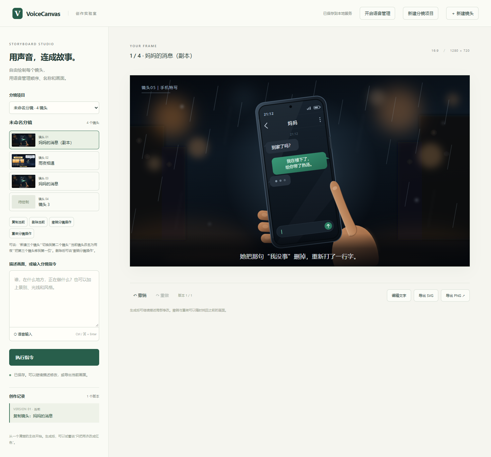
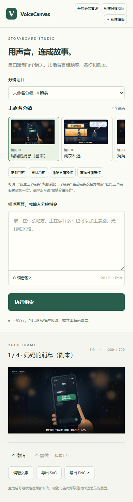

# 自由 SVG 分镜语音编排验收（2026-11-17）

本次验证分镜管理闭环，未新增在线模型调用。研究目录和测试数据库位于 D 盘，未下载安装新工具。复用已有 Playwright、Edge、Python 和 Node。

## 验证方式与结果

FastAPI 使用产品路由、服务和真实 SQLite。绘图生成器替换为以前已保存的街景与手机 SVG 响应，修改用确定性替换；因此图片只证明流程和画面保存，不代表本次模型画质。浏览器在 SpeechRecognition/speechSynthesis 边界模拟最终转写与播报完成事件，实际运行产品识别适配器、VoiceSessionController、HTTP 请求及下载；没有真实录音与语音服务准确率证据。

- 连续最终转写：新建两个镜头、切换、命名、分别画街景/手机、复制、排序、删除确认、撤销结构，均按稳定 ID 保存并恢复监听。
- “查看分镜”返回当前顺序；“导出SVG”触发有效下载；“导出当前镜头”触发 1280×720 PNG 下载，无下载错误。
- “删除第二个镜头”不立即删除，“取消”保持数量；“关闭麦克风”结束持续会话。
- 直接改字保存 HTTP 200，刷新后仍有该文字修改版本；草稿未应用时点击新增被拦截。
- 刷新恢复四个镜头、顺序、当前选择、版本和缩略图，无自动模型调用。
- 桌面 1500×1150 与窄屏 390×844 检查；窄屏 document.scrollWidth 为 390，没有整页横向溢出。分镜卡片横向滚动。
- 两个页面先后操作同一项目：第一页面新增，旧页面复制收到冲突并同步到五个镜头，没有重复新增；随后撤销恢复四个。页面未捕获 JavaScript 错误。

后端全量执行结果 282 passed、1 skipped（后续增加六个解析变体，分镜专项 35 passed）。Ruff 通过，六个新/相关源模块 Mypy 通过。前端 `npm test`：原型契约通过，24 个客户端/排版测试通过。既有 Starlette/httpx 弃用提示不影响测试，本次没有调整依赖。

复现命令及真实麦克风现场验收步骤见 [语音分镜管理](../../语音分镜管理.md)。图片为研发验证数据，不是生产作品。

