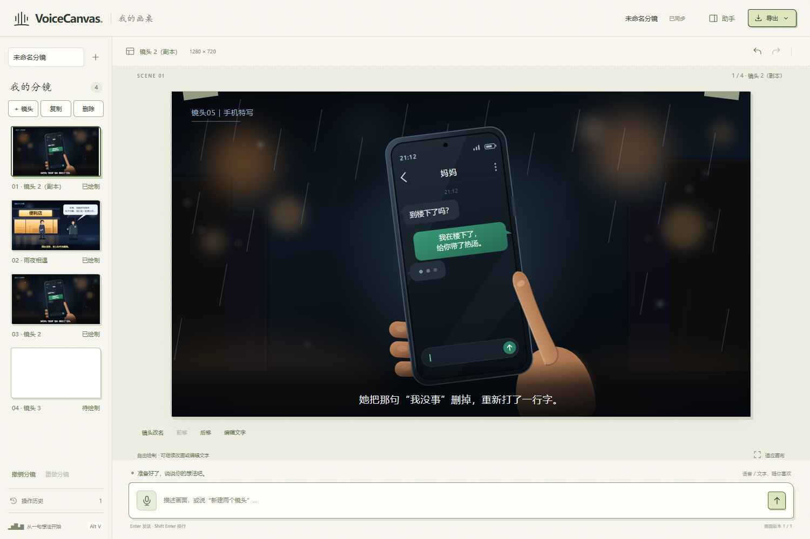
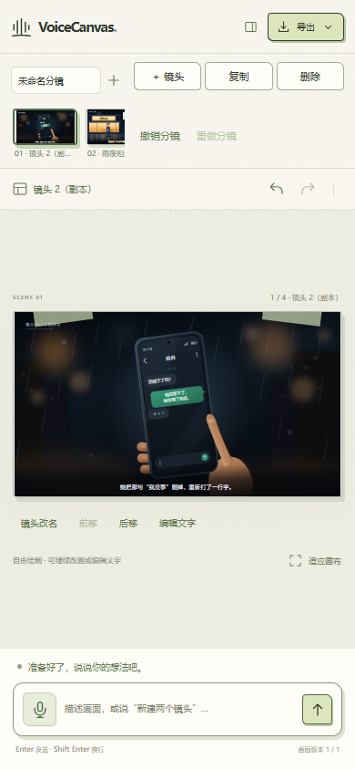

# main 工作台接入自由 SVG 分镜

前端使用 main（`9ce40d4`）的手绘纸张首页与三栏画桌，保持原导航、配色、侧栏卡片、助手面板、底部输入框和响应式布局。新增能力通过接口适配进入这套页面，统一以自由 SVG 分镜为创作流程，已删除旧入口和控制器。

## 路由与能力

- `index.html` 首页浏览画廊不创建项目，点击创作后向 `/api/storyboards` 创建分镜，再进入 `workspace.html?board=…`。
- 无定位参数的 `workspace.html` 恢复上次自由分镜，没有记录时创建一个空项目；`board` 使用自由分镜 API。
- 已删除 `shot.html`、迁移跳转、旧工作台控制器和专用渲染模块。首页不再按旧参数重定向，工作台直接加载自由分镜流程。
- 自由分镜左侧选择项目、增加/复制/删除镜头、撤销结构；画布下方改名、前后移动和直接改字；右侧显示处理反馈与删除确认；顶部导出 PNG/SVG。
- 输入框左侧麦克风使用连续语音，快捷键 Alt+V；Enter 发送，Shift+Enter 换行。Ctrl+Z 撤销当前画面，Ctrl+Shift+Z 重做，不抢占文本输入的撤销。

自由分镜使用 `/api/storyboards` 与 `/api/shots`，不把 SVG 硬转为旧预设元素。只有服务端返回成功后更新业务状态；元数据与画面历史分开管理，冲突由原客户端同步且不自动重试模型。未应用的文字草稿阻止切换；直接文字保存按独立画面版本提交。

未接入的 JSON 导入导出、偏好记忆和整体背景控件已从页面移除。自由分镜仍未实现跨镜头角色一致性、整组导出或任意复合语音命令。API 及句式边界见 [语音分镜管理](语音分镜管理.md)。

## 运行测试

产品启动沿用根 README，浏览 `http://127.0.0.1:4178/index.html`。前端没有增加包或下载步骤。先运行基础验证：

```powershell
cd frontend
npm test
cd ../backend
python -m pytest -q
```

浏览器测试使用真实 API 和 SQLite，固定生成器返回一张带中文的 SVG，无模型调用。数据库放入指定临时目录。以下终端从仓库根目录分别启动：

```powershell
# 终端 1，目录需已存在；可自行改为 D 盘测试目录
cd backend
$env:PYTHONPATH="src"
$env:VOICECANVAS_E2E_DATA_DIR="D:/Project/CodexResearch/voicecanvas-main-workspace-20261117"
python -m uvicorn browser_fixture:app --app-dir tests --host 127.0.0.1 --port 8015
```

```powershell
# 终端 2
cd frontend
npm run prototype
```

```powershell
# 终端 3，复用本机现有工具；替换为自己的已安装路径
cd frontend
$env:VOICECANVAS_PLAYWRIGHT_PACKAGE="C:/Users/86180/.cache/codex-runtimes/codex-primary-runtime/dependencies/node/package.json"
$env:VOICECANVAS_BROWSER_PATH="C:/Program Files (x86)/Microsoft/Edge/Application/msedge.exe"
$env:VOICECANVAS_E2E_OUTPUT="D:/Project/CodexResearch/voicecanvas-main-workspace-20261117/e2e"
npm run test:workspace-browser
```

Playwright 已在当前 frontend 的 Node 模块解析路径时可省略 PACKAGE；默认使用其已安装浏览器，也可通过 BROWSER_PATH 指定 Edge。测试 API 默认 8015、UI 默认 4178，可以通过 `VOICECANVAS_E2E_API_URL` 与 `VOICECANVAS_E2E_UI_URL` 覆盖；产品 CORS 默认只允许 localhost/127.0.0.1:4178。测试服务仅供研发验收，勿用作真实绘图后端。

## 实际验证

2026-11-17，复用 D 盘已有 Python/Node 和本机 Playwright/Edge，没有安装依赖。`npm test`：原型契约、7 个首页测试、24 个自由分镜/排版测试通过。`test:workspace-browser` 通过：首页真实创建 → 新增/切换 → 固定绘图 → 改字与草稿保护 → 复制排序 → 删除确认/结构恢复 → 语音最终转写 → 刷新 → PNG 下载 → 窄屏比例 → 确认旧页面 404、旧参数不分流。

后端全量复验为 此前全量为 297 passed、1 skipped；本次移除迁移后，分镜专项 34 passed，相关 Python 文件 Ruff 通过。首次全量运行中旧记忆服务测试遇到同一时钟刻度的时间戳断言失败；该用例单独复验及全量复验均通过，本次未修改记忆服务逻辑。既有 Starlette/httpx 弃用提示保留。

另使用以前保存的模型 SVG 回放检查复杂画面，截图如下。390px 窄屏无整页横向溢出，画布保持 16:9；手机助手以浮层展示，可以顶部按钮收起。语音只模拟 ASR/TTS 边界，真实麦克风准确率需要现场验证。图片来自历史响应，不代表本次生成效果。




