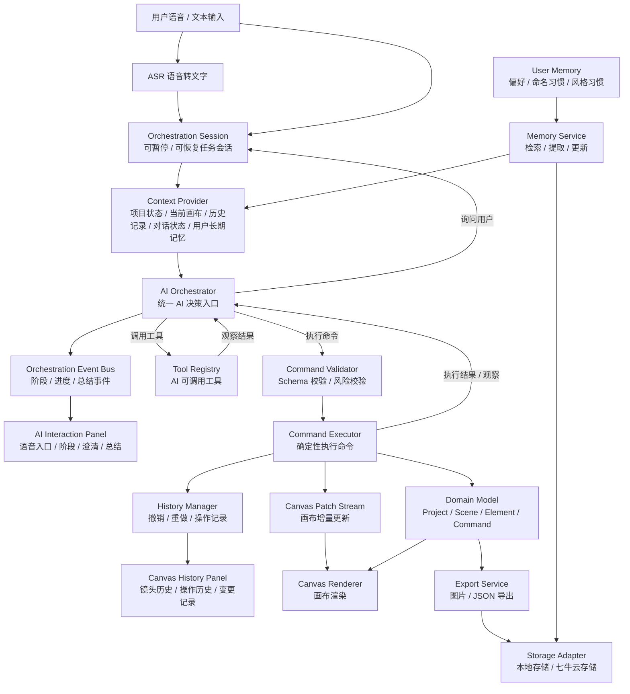
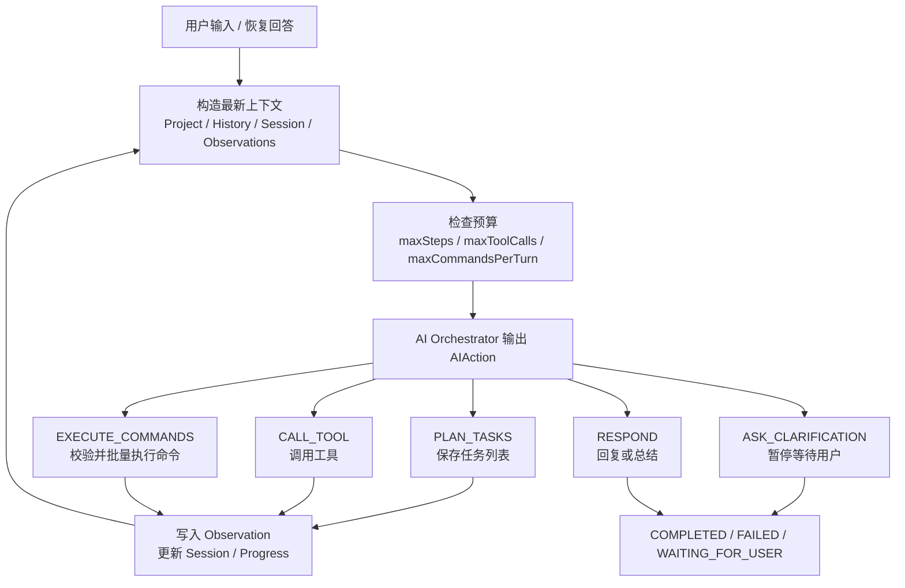
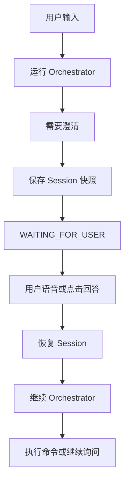

# VoiceCanvas 技术架构设计

> 本文档沉淀 VoiceCanvas 当前确认的技术架构。后续如果语音交互、AI 编排、画布执行或七牛云接入方案发生变化，应同步更新本文档和关联决策记录。

## 架构结论

VoiceCanvas 采用 **可恢复 AI 编排器架构**：

> 所有用户语音或文本输入统一进入 AI Orchestrator。AI 根据当前画布、项目状态和对话上下文，自主决定是直接生成结构化命令、调用工具查询或执行、拆解多步任务，还是向用户澄清。当需要澄清时，系统暂停当前编排会话，等待用户用语音或点击选项回答，再从原状态继续执行。所有写操作最终都经过 Schema 校验和 CommandExecutor，保证画布状态稳定、可撤销、可测试、可扩展。

## 核心原则

- 不做规则解析：系统不通过关键词、正则或固定 if 分支理解用户绘图语义。
- 不提前判断复杂度：系统不在 AI 之前区分简单命令、复杂命令或多步任务。
- AI 负责理解和编排：AI 可以决定直接执行命令、调用工具、继续拆解任务或询问用户。
- 系统负责确定性执行：AI 不能直接覆盖画布状态，所有写操作必须进入命令校验和命令执行器。
- 不确定时暂停而不是取消：Orchestrator 进入 `WAITING_FOR_USER` 状态，保存执行上下文，等待用户回答后恢复。
- 画布支持流式更新：复杂任务不必等整轮 AI 完成后一次性刷新，命令可以分批执行，画布随状态增量实时更新。
- 左侧画布历史承载创作脉络：展示镜头历史、操作历史、撤销重做线索和关键变更记录。
- 右侧 AI 交互栏承载任务过程：用户主要通过语音沟通，同时在右侧查看当前阶段、澄清问题、执行进度和本轮变更总结。
- 记忆分层存储：短期记忆以 Project State、History 和 OrchestrationSession 为主；长期记忆以 User Memory 保存用户偏好、命名习惯、布局习惯和风格偏好。
- 工具调用不绕过业务层：写入类工具内部仍然调用 CommandExecutor。
- 长期记忆不能静默污染：从用户行为中抽取出的长期偏好必须有置信度、来源和可撤销能力，必要时通过右侧 AI 交互栏询问用户确认。
- 七牛云能力作为适配器接入：核心领域层不依赖七牛云 SDK。

## 总体架构



页面布局建议：

- 左侧：画布历史区，包含镜头历史、操作历史、关键变更记录、撤销/重做状态。
- 中间：主画布，随命令执行流式更新。
- 右侧：AI 交互栏，包含语音按钮、实时转写、当前任务阶段、执行进度、澄清选项、本轮变更总结。
- 下方或画布附近：元素属性、导出入口等辅助面板。MVP 可先把高级属性面板弱化，优先保证语音创作主链路。

## Orchestrator 动作协议

Orchestrator 每一步只输出标准动作，业务层根据动作类型继续推进。

```ts
type AIAction =
  | {
      type: "PLAN_TASKS";
      plan: TaskPlan;
    }
  | {
      type: "EXECUTE_COMMANDS";
      commands: CanvasCommand[];
    }
  | {
      type: "CALL_TOOL";
      toolName: string;
      arguments: unknown;
    }
  | {
      type: "ASK_CLARIFICATION";
      question: string;
      options?: ClarificationOption[];
      expectedAnswerType:
        | "element_selection"
        | "scene_selection"
        | "export_format"
        | "confirmation"
        | "free_text";
      resumePolicy: {
        sessionId: string;
        clarificationId: string;
        allowVoiceAnswer: boolean;
        allowOptionSelection: boolean;
      };
    }
  | {
      type: "RESPOND";
      message: string;
    };
```

说明：

- `PLAN_TASKS`：AI 先把复杂需求拆成任务列表，系统保存计划并继续下一轮编排。
- `EXECUTE_COMMANDS`：AI 已经能确定当前可执行步骤，输出一组结构化画布命令。执行完成后结果会回灌给 Orchestrator，由 Orchestrator 判断是否继续。
- `CALL_TOOL`：AI 需要查询状态或执行系统能力。工具返回结果会作为 observation 回灌给 Orchestrator。
- `ASK_CLARIFICATION`：AI 需要用户补充信息，当前任务暂停等待回答。
- `RESPOND`：普通回复，不修改画布状态。只有当 session 被标记为 `COMPLETED`、`FAILED` 或 `WAITING_FOR_USER` 时，本轮才结束。

任务计划结构：

```ts
type TaskPlan = {
  goal: string;
  tasks: TaskItem[];
};

type TaskItem = {
  id: string;
  title: string;
  status: "pending" | "in_progress" | "completed" | "failed" | "skipped";
  dependsOn?: string[];
  relatedSceneId?: string;
  relatedElementIds?: string[];
};
```

## Orchestrator 循环执行模型

Orchestrator 不是“一次输出、一执行就结束”的解析器，而是一个有预算限制的循环编排器。一次用户输入可能经历多轮 AI 决策、工具调用、命令批量执行和状态观察。



伪代码：

```ts
async function runOrchestratorLoop(session: OrchestrationSession) {
  while (session.status === "RUNNING") {
    assertWithinBudget(session);

    const context = buildLatestContext(session);
    const action = await orchestrator.next(context);
    session.plannedActions.push(action);

    if (action.type === "PLAN_TASKS") {
      session.taskPlan = action.plan;
      eventBus.publish({ type: "PROGRESS", progress: planToProgress(action.plan) });
      continue;
    }

    if (action.type === "CALL_TOOL") {
      const result = await toolRunner.run(action, getCurrentProject());
      session.observations.push({ type: "tool_result", result });
      continue;
    }

    if (action.type === "EXECUTE_COMMANDS") {
      const validCommands = validator.validate(action.commands, getCurrentProject());
      const result = await executor.executeBatch(validCommands.value, getCurrentProject());
      session.observations.push({ type: "command_result", result });
      updateTaskPlanFromCommandResult(session, result);

      if (result.failed) {
        session.observations.push({ type: "partial_failure", failed: result.failed });
      }

      continue;
    }

    if (action.type === "ASK_CLARIFICATION") {
      pauseForClarification(session, action);
      return;
    }

    if (action.type === "RESPOND") {
      completeOrContinueFromResponse(session, action);
      return;
    }
  }
}
```

循环结束条件：

- Orchestrator 输出 `ASK_CLARIFICATION`，session 进入 `WAITING_FOR_USER`。
- Orchestrator 输出最终 `RESPOND`，session 进入 `COMPLETED`。
- 工具调用或命令执行发生不可恢复错误，session 进入 `FAILED`。
- 达到执行预算，系统总结已完成内容并询问用户是否继续。
- 用户主动取消，session 进入 `CANCELLED`。

重要约束：

- `EXECUTE_COMMANDS` 可以包含多条命令，但执行完成后不会自动结束本轮；执行结果会作为 observation 回到 Orchestrator。
- `CALL_TOOL` 可以连续发生多次，但必须受 `maxToolCalls` 限制。
- `PLAN_TASKS` 只更新 session 中的计划和进度，不直接修改 Project。
- 任务列表是编排状态，不是画布状态；真正改变画布的仍然只有 CommandExecutor。
- 如果一批命令部分失败，已成功执行的命令保留在 History 中，Orchestrator 根据 observation 决定修复、询问用户、跳过或总结。

## 运行事件与右侧 AI 交互栏

Orchestrator 动作负责推进任务，运行事件负责把过程反馈给 UI。右侧 AI 交互栏订阅运行事件，不直接修改画布状态。

```ts
type OrchestrationEvent =
  | {
      type: "TRANSCRIPT_PARTIAL";
      text: string;
    }
  | {
      type: "TRANSCRIPT_FINAL";
      text: string;
    }
  | {
      type: "STAGE_CHANGED";
      stage:
        | "listening"
        | "understanding"
        | "planning"
        | "calling_tool"
        | "executing"
        | "waiting_for_user"
        | "summarizing"
        | "completed"
        | "failed";
      message?: string;
    }
  | {
      type: "PROGRESS";
      completedSteps: number;
      totalSteps?: number;
      message?: string;
    }
  | {
      type: "CANVAS_PATCH_APPLIED";
      patch: CanvasPatch;
      commandId: string;
    }
  | {
      type: "CLARIFICATION_REQUESTED";
      question: string;
      options?: ClarificationOption[];
    }
  | {
      type: "TURN_SUMMARY";
      summary: TurnSummary;
    };
```

右侧 AI 交互栏需要展示：

- 语音输入状态：监听中、识别中、已识别文本。
- 当前阶段：例如“正在理解需求”“正在创建镜头”“等待你选择标题”。
- 可回答的澄清问题：支持语音回答，也支持点击选项。
- 执行进度：复杂任务可展示已完成步骤数和当前步骤说明。
- 本轮变更总结：AI 在一轮任务结束后返回新增、修改、删除、导出等结果。

本轮总结建议结构：

```ts
type TurnSummary = {
  userInput: string;
  completed: boolean;
  stage: "completed" | "waiting_for_user" | "partial" | "failed";
  changes: Array<{
    type: "created" | "updated" | "deleted" | "exported" | "asked";
    targetType: "scene" | "element" | "project" | "export" | "conversation";
    targetName?: string;
    description: string;
  }>;
  nextQuestion?: string;
  warnings?: string[];
};
```

## 左侧画布历史区

左侧画布历史区用于让用户回看创作过程，而不是承载 AI 对话。它订阅 HistoryManager 和 CanvasPatch，不直接修改项目状态。

建议展示内容：

- 镜头历史：当前项目中的镜头列表、当前激活镜头、每个镜头的最近更新时间。
- 操作历史：本轮和历史轮次中执行过的命令摘要，例如“新增标题”“移动商品”“删除标签”。
- 关键变更记录：按时间展示重要 CanvasPatch，便于用户理解画布是如何逐步形成的。
- 撤销/重做状态：展示是否可以撤销或重做，MVP 可提供按钮，也可只展示状态并通过语音触发。
- 失败或部分完成记录：如果复杂任务只完成了一部分，需要在历史中保留已完成部分和失败原因。

左侧历史区与右侧 AI 交互栏的区别：

- 左侧回答“画布经历了什么变化”。
- 右侧回答“AI 现在在做什么、需要用户回答什么、本轮最终改了什么”。
- 中间画布回答“当前结果是什么”。

## 短期记忆与长期记忆

VoiceCanvas 需要同时管理两类记忆：

- 短期记忆：当前项目内有效，以 Project State、History、CanvasPatch、OrchestrationSession 为主。
- 长期记忆：跨项目有效，以 User Memory 保存用户偏好、命名习惯、布局习惯和风格偏好。

短期记忆示例：

- 当前项目有几个镜头。
- 当前激活的是哪个镜头。
- 用户刚刚新增了哪个元素。
- 本轮任务已经执行了哪些命令。
- 哪些命令可以撤销或重做。

长期记忆示例：

- 用户习惯把第一个分镜叫做“主图”。
- 用户说“太阳”时，通常喜欢放在左上角。
- 用户偏好清爽绿色、小红书风、简洁促销风。
- 用户常用“卖点标签”“价格牌”“购买按钮”这些命名。
- 用户创建带货分镜时，常用“主图、卖点、转化”三段结构。

设计原则：

- Project State 是项目事实，User Memory 是用户倾向，二者不能混写。
- 长期记忆只作为 Orchestrator 上下文建议，不直接绕过用户当前指令。
- 当用户当前指令和长期偏好冲突时，当前指令优先。
- 低置信度偏好不直接写入长期记忆，应先作为候选记忆，必要时询问用户确认。
- 用户必须能查看、修改、删除长期记忆。

长期记忆写入流程：

```text
用户行为 / 对话 / 命令结果
-> MemoryExtractor 提取候选偏好
-> 计算置信度和来源
-> 高置信度且低风险：写入 User Memory
-> 低置信度或可能影响体验：右侧 AI 交互栏询问确认
-> 用户确认后写入，拒绝则丢弃候选
```

长期记忆使用流程：

```text
用户输入
-> Context Provider 检索相关 User Memory
-> 注入 OrchestratorInput
-> Orchestrator 结合当前项目状态和用户长期偏好生成下一步动作
```

MVP 可以先实现本地长期记忆；比赛展示时可以把“用户越用越懂你”作为加分项亮点。

## 可恢复澄清流程

当 AI 不确定时，系统不是取消任务，而是保存当前会话并等待用户回答。



会话状态建议：

```ts
type OrchestrationStatus =
  | "RUNNING"
  | "WAITING_FOR_USER"
  | "COMPLETED"
  | "FAILED"
  | "CANCELLED";

type OrchestrationSession = {
  id: string;
  status: OrchestrationStatus;
  originalUserInput: string;
  currentUserInput?: string;
  projectContextSnapshot: ProjectContext;
  conversationState: ConversationState;
  pendingClarification?: PendingClarification;
  taskPlan?: TaskPlan;
  observations: OrchestrationObservation[];
  plannedActions: AIAction[];
  executedCommandIds: string[];
  currentStage:
    | "listening"
    | "understanding"
    | "planning"
    | "calling_tool"
    | "executing"
    | "waiting_for_user"
    | "summarizing"
    | "completed"
    | "failed";
  progress?: {
    completedSteps: number;
    totalSteps?: number;
    message?: string;
  };
  lastSummary?: TurnSummary;
  stepCount: number;
  createdAt: number;
  updatedAt: number;
};
```

Observation 类型建议：

```ts
type OrchestrationObservation =
  | {
      type: "plan_updated";
      plan: TaskPlan;
      createdAt: string;
    }
  | {
      type: "tool_result";
      result: ToolResult;
      createdAt: string;
    }
  | {
      type: "command_result";
      result: BatchExecutionResult;
      createdAt: string;
    }
  | {
      type: "partial_failure";
      failed: {
        command: CanvasCommand;
        error: string;
      };
      createdAt: string;
    };
```

用户回答恢复策略：

- 存在 `WAITING_FOR_USER` 会话时，下一句语音默认作为澄清回答。
- 用户可以通过“取消”“算了”等表达取消当前会话。
- 用户也可以表达“先别管这个，帮我……”来中断并开始新任务。
- 恢复时使用最新项目状态，同时保留旧快照用于冲突检测。

## 画布流式更新

复杂任务可能包含多条命令，例如创建三镜头分镜、为每个镜头添加元素、统一调整风格。系统应在每批命令执行后立即更新画布，而不是等 AI 完成本轮全部思考后再一次性刷新。

流式更新链路：

```text
AIAction EXECUTE_COMMANDS
-> Command Validator
-> Command Executor 分批执行
-> 产生 CanvasPatch
-> 更新 Project State
-> Canvas Renderer 订阅 Patch 并局部刷新
-> AI 交互栏同步展示进度
```

画布增量建议：

```ts
type CanvasPatch =
  | {
      type: "SCENE_CREATED";
      scene: Scene;
    }
  | {
      type: "SCENE_UPDATED";
      sceneId: string;
      patch: Partial<Scene>;
    }
  | {
      type: "ELEMENT_ADDED";
      sceneId: string;
      element: CanvasElement;
    }
  | {
      type: "ELEMENT_UPDATED";
      sceneId: string;
      elementId: string;
      patch: Partial<CanvasElement>;
    }
  | {
      type: "ELEMENT_DELETED";
      sceneId: string;
      elementId: string;
    };
```

实现约束：

- Project State 仍然是唯一可信状态，Patch 只是 UI 增量刷新和动画反馈的数据。
- 每个 Patch 必须能追溯到对应 `commandId`，便于历史记录、撤销重做和调试。
- 流式更新不能绕过 CommandValidator 和 CommandExecutor。
- 如果一批命令中后续命令失败，已成功执行的命令保留在历史记录中，AI 交互栏需要说明“已完成哪些、哪些未完成、是否需要继续”。

## 命令执行链路

所有写操作统一进入以下链路：

```text
AIAction
-> Command Validator
-> Command Executor
-> Domain Model
-> Canvas Patch Stream
-> History Manager
-> Canvas Renderer
-> Command Observation
-> Orchestrator Loop
```

禁止 AI 直接返回完整 Project JSON 覆盖当前状态。复杂任务应拆解为任务列表和一组可验证、可回放、可撤销的命令批次。每个命令批次执行后，系统把执行结果作为 observation 回灌给 Orchestrator，由 Orchestrator 决定继续执行下一批命令、调用工具、询问用户或总结完成。

示例命令类型：

```ts
type CanvasCommand =
  | CreateSceneCommand
  | SwitchSceneCommand
  | AddElementCommand
  | UpdateElementCommand
  | DeleteElementCommand
  | ArrangeLayoutCommand
  | ExportCommand;
```

命令校验职责：

- 校验字段是否完整。
- 校验目标元素或镜头是否存在。
- 校验坐标、尺寸、颜色、图层等参数是否合法。
- 对清空、删除多个元素、覆盖导出等风险操作要求确认。
- 校验失败时可以请求 AI 修复命令，或进入用户澄清流程。

## AI 工具设计

工具是暴露给 AI 的系统能力。工具可以读状态，也可以发起写操作，但写操作内部仍然必须走 CommandExecutor。

只读工具：

- `getProjectSummary`：获取项目摘要。
- `getCurrentScene`：获取当前镜头。
- `listScenes`：获取镜头列表。
- `listElements`：获取当前镜头元素。
- `findElement`：根据名称、类型、位置查找元素。
- `getHistorySummary`：获取最近操作记录。

写入工具：

- `createScene`：创建镜头。
- `switchScene`：切换镜头。
- `addElement`：添加元素。
- `updateElement`：修改元素。
- `deleteElement`：删除元素。
- `arrangeLayout`：调整布局。
- `exportImage`：导出图片。
- `exportJson`：导出 JSON。

工具返回结果建议：

```ts
type ToolResult = {
  success: boolean;
  toolName: string;
  commandIds?: string[];
  changedSceneId?: string;
  message?: string;
  stateSummary?: ProjectSummary;
  error?: {
    code: string;
    message: string;
  };
};
```

## 领域模型

领域模型必须保持纯净，不依赖 React、AI SDK、ASR SDK 或七牛云 SDK。

```ts
type Project = {
  id: string;
  title: string;
  scenes: Scene[];
  activeSceneId: string;
  createdAt: string;
  updatedAt: string;
};

type Scene = {
  id: string;
  name: string;
  description?: string;
  elements: CanvasElement[];
};

type CanvasElement = {
  id: string;
  name?: string;
  type: "text" | "shape" | "image" | "connector" | "unknown";
  x: number;
  y: number;
  width: number;
  height: number;
  zIndex: number;
  style?: Record<string, unknown>;
};
```

## 推荐模块划分

```text
src/
  app/
    App.tsx
    providers/

  features/
    canvas-history/
      CanvasHistoryPanel.tsx
      SceneHistoryList.tsx
      OperationTimeline.tsx
      UndoRedoStatus.tsx
    ai-panel/
      AIInteractionPanel.tsx
      VoiceControl.tsx
      StageIndicator.tsx
      TurnSummaryCard.tsx
    canvas/
    voice-input/
    storyboard/
    export-panel/

  ai/
    orchestrator/
      AIOrchestrator.ts
      runOrchestratorLoop.ts
    prompts/
      orchestratorPrompt.ts
      repairPrompt.ts
    schemas/
      aiActionSchema.ts
      commandSchema.ts

  application/
    command-executor/
      CommandExecutor.ts
    command-validator/
      CommandValidator.ts
    orchestration-session/
      OrchestrationSession.ts
      OrchestrationSessionStore.ts
      resumeOrchestration.ts
    orchestration-events/
      OrchestrationEventBus.ts
      OrchestrationEvent.ts
    clarification/
      ClarificationManager.ts
      ClarificationResolver.ts
    tool-runner/
      ToolRunner.ts
      ToolRegistry.ts

  domain/
    project/
      Project.ts
    scene/
      Scene.ts
    element/
      CanvasElement.ts
    command/
      CanvasCommand.ts
    history/
      HistoryManager.ts
    patch/
      CanvasPatch.ts

  adapters/
    llm/
      LLMClient.ts
      OpenAIClient.ts
      MockLLMClient.ts
    asr/
      SpeechRecognizer.ts
      BrowserSpeechRecognizer.ts
    storage/
      LocalProjectStorage.ts
      QiniuAssetStorage.ts
    export/
      JsonExporter.ts
      ImageExporter.ts

  infrastructure/
    qiniu/
    logging/
    config/

  tests/
```

## 七牛云接入方式

七牛云相关能力只出现在适配器层和基础设施层。

```ts
interface AssetStorage {
  upload(file: File): Promise<AssetRef>;
  getUrl(assetId: string): Promise<string>;
  delete(assetId: string): Promise<void>;
}
```

推荐实现：

- `LocalAssetStorage`：MVP 本地开发与离线演示使用。
- `QiniuAssetStorage`：比赛展示七牛云对象存储、素材上传、资源访问能力时使用。

应用层只依赖 `AssetStorage` 接口，不感知具体存储供应商。

## 执行预算

为避免 AI 编排循环无限运行，需要设置预算：

```ts
const orchestrationLimits = {
  maxSteps: 6,
  maxToolCalls: 5,
  maxCommandsPerTurn: 30
};
```

超过预算时，系统应总结已完成内容，并询问用户是否继续。

## 测试策略

每个核心模块完成后都要提供可运行测试。

建议测试分层：

- domain 测试：Project、Scene、CanvasElement、Command 数据结构和纯逻辑。
- command-executor 测试：创建镜头、添加元素、修改元素、删除元素、撤销、重做。
- command-validator 测试：非法命令拦截、缺字段报错、风险操作确认。
- AI Orchestrator 测试：Mock LLM 分别返回 `PLAN_TASKS`、`EXECUTE_COMMANDS`、`CALL_TOOL`、`ASK_CLARIFICATION`、`RESPOND`。
- 编排循环测试：任务计划、工具结果和命令执行结果能作为 observation 回灌，并触发下一轮 Orchestrator 决策。
- orchestration-session 测试：进入 `WAITING_FOR_USER`、保存快照、语音回答后恢复执行、取消会话。
- orchestration-events 测试：阶段事件、进度事件、澄清事件和本轮总结事件能正确发出。
- tool-runner 测试：只读工具返回状态，写入工具通过 CommandExecutor 修改状态。
- memory 测试：用户偏好能被保存、检索、更新、删除；低置信度候选记忆需要确认后才能写入。
- context-provider 测试：当前项目上下文和相关长期记忆能一起注入 OrchestratorInput，且当前指令优先于长期偏好。
- canvas 测试：元素正确渲染，收到 CanvasPatch 后局部更新。
- 右侧 AI 交互栏测试：语音状态、当前阶段、澄清选项和本轮总结能正确展示。
- 左侧画布历史区测试：镜头历史、操作历史、撤销重做状态和部分失败记录能正确展示。
- export 测试：导出 JSON 和图片。
- e2e 测试：用户语音创建三镜头分镜，画布逐步更新；回答澄清问题后继续执行；任务结束后展示本轮变更总结并支持导出。

推荐工具：

- 单元测试：Vitest。
- 组件测试：React Testing Library。
- 端到端测试：Playwright。
- Schema 校验：Zod。

## 当前落地顺序

MVP 建议按以下顺序实现：

1. 领域模型：Project、Scene、CanvasElement、CanvasCommand。
2. 命令执行器：创建镜头、添加元素、修改元素、删除元素、撤销、重做。
3. Schema 校验：AIAction 和 CanvasCommand 的 Zod schema。
4. Mock LLM Orchestrator：模拟 `PLAN_TASKS`、工具调用、命令批量执行、澄清和最终总结。
5. runOrchestratorLoop：实现 observation 回灌、预算检查和循环结束条件。
6. 可恢复会话：支持 `WAITING_FOR_USER`、语音回答恢复、取消会话。
7. OrchestrationEventBus：输出阶段、进度、澄清和本轮总结事件。
8. 画布流式更新：将结构化元素渲染到画布，并支持 CanvasPatch 局部刷新。
9. 右侧 AI 交互栏：支持语音入口、阶段展示、澄清选项和本轮总结。
10. 左侧画布历史区：支持镜头历史、操作历史、撤销重做状态和关键变更记录。
11. User Memory：实现本地用户偏好存储、检索、候选记忆确认和删除。
12. 工具注册表：先实现只读工具，再实现写入工具。
13. 真实 LLM 接入：替换 Mock LLM。
14. ASR 接入：接入浏览器语音或第三方语音识别。
15. 导出与存储：本地 JSON/图片导出，随后接入七牛云存储。
