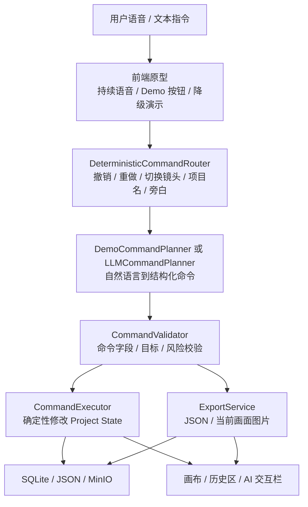

# VoiceCanvas 指令完成情况

> 本文档用于给评委和面试官快速核对：VoiceCanvas 预计支持哪些语音指令、当前已经完成哪些、哪些只做了降级或部分完成、哪些未完成以及原因。本文档以当前代码为准，避免把规划能力误写成已完成能力。

## 状态定义

| 状态 | 含义 |
| --- | --- |
| 已完成 | 当前业务链路、前端展示和测试已覆盖，可按 README 启动后验证 |
| 降级完成 | 主流程不中断，但视觉效果或语义理解范围有明确降级 |
| 部分完成 | 底层命令或局部链路已完成，但 Demo Planner 或前端交互尚未覆盖全部口语 |
| 未完成 | 当前不作为 MVP 验收承诺，需要后续 PR 实现 |

## 当前指令入口



说明：

- 所有写入类绘图指令最终都必须落到 `CanvasCommand`，并经过 `CommandValidator` 与 `CommandExecutor`。
- `EXPORT_PROJECT` 不由 `CommandExecutor` 直接写画布，而是由 `ExportService` 执行导出。
- `undo`、`redo` 是编排结果类型，不是 `CommandType` 枚举值；它们由历史管理链路处理。
- Demo Planner 只覆盖比赛主线语料；真实 LLM Planner 可覆盖更自然的表达，但仍受结构化命令和校验器约束。

## 预计实现指令

当前领域层定义的目标命令集合如下：

| 指令类型 | 目标用途 | 当前状态 |
| --- | --- | --- |
| `UPDATE_PROJECT` | 修改项目标题等项目级设置 | 已完成 |
| `CREATE_SCENE` | 创建新镜头或分镜 | 已完成 |
| `UPDATE_SCENE` | 修改镜头名称、说明、旁白、画布背景等 | 已完成 |
| `CLEAR_SCENE` | 清空当前镜头元素，高风险指令需确认 | 已完成 |
| `DELETE_SCENE` | 删除镜头并维护 active scene | 已完成 |
| `SWITCH_SCENE` | 切换当前镜头 | 已完成 |
| `ADD_ELEMENT` | 添加文字、商品、标签、连接线、未知元素等 | 已完成 |
| `UPDATE_ELEMENT` | 修改文字、描述、颜色、位置、尺寸等元素字段 | 已完成 |
| `DELETE_ELEMENT` | 删除指定元素，并处理连接线失效降级 | 已完成 |
| `ARRANGE_LAYOUT` | 居中、置顶、置底、布局恢复 | 部分完成 |
| `EXPORT_PROJECT` | 导出项目 JSON 或当前画面图片 | 已完成 |
| `ASK_CLARIFICATION` | 指令目标不明确时请求用户确认 | 已完成 |
| `UNDO` | 撤销最近一次可回放操作 | 已完成 |
| `REDO` | 恢复最近一次撤销操作 | 已完成 |

## 已完成指令清单

| 能力 | 示例语音 | 实际落点 | 验证方式 |
| --- | --- | --- | --- |
| 创建三镜头分镜 | 创建一个三镜头的珍珠奶茶带货分镜，主打低糖和新品上市 | `CREATE_SCENE`、`UPDATE_SCENE`、`ADD_ELEMENT` | `pytest tests/test_demo_command_planner.py tests/test_orchestration_service.py` |
| 切换镜头 | 切换到第二镜头 | `SWITCH_SCENE`，确定性路由和 Demo Planner 均覆盖 | `pytest tests/test_deterministic_command_router.py tests/test_demo_command_planner.py` |
| 删除最后一个镜头 | 删除最后一个镜头 | `DELETE_SCENE`，删除当前镜头时自动切到最近可用镜头 | `pytest tests/test_command_executor.py tests/test_demo_command_planner.py` |
| 修改项目名称 | 项目名称改成低糖奶茶带货 | `UPDATE_PROJECT` | `pytest tests/test_deterministic_command_router.py tests/test_command_validator.py` |
| 设置旁白字幕 | 第二镜头旁白改成突出低糖卖点 | `UPDATE_SCENE` | `pytest tests/test_deterministic_command_router.py` |
| 添加标题 | 加一行标题，写新品上市 | `ADD_ELEMENT`，`type=text` | `pytest tests/test_demo_command_planner.py` |
| 添加商品 | 在第二镜头加一个奶茶产品 | `ADD_ELEMENT`，`type=generated_asset`，带 `assetPath` | `pytest tests/test_demo_command_planner.py tests/test_render_catalog.py` |
| 添加优惠标签 | 加一个红色优惠标签，写立减十元 | `ADD_ELEMENT`，`type=text` | `pytest tests/test_demo_command_planner.py` |
| 添加箭头或连接线 | 给第二镜头加一个箭头，指向核心卖点 | `ADD_ELEMENT`，`type=connector` | `npm run test:prototype` |
| 修改标题文字 | 把标题改成低糖也好喝 | `UPDATE_ELEMENT` | `pytest tests/test_demo_command_planner.py tests/test_command_executor.py` |
| 修改背景色 | 背景改成浅绿色 | `UPDATE_SCENE`，修改 `scene.canvas.background` | `npm run test:prototype` |
| 修改元素描述 | 商品说明改成主打低糖新品 | `UPDATE_ELEMENT`，写入 `description` | `pytest tests/test_demo_command_planner.py` |
| 放大商品 | 把商品放大一点 | `UPDATE_ELEMENT`，修改宽高并同步 transform | `pytest tests/test_command_executor.py`、`npm run test:prototype` |
| 删除标题 | 删除标题 | `DELETE_ELEMENT` | `pytest tests/test_demo_command_planner.py tests/test_command_executor.py` |
| 清空当前镜头 | 清空当前画布 | 先 `ASK_CLARIFICATION`，确认后 `CLEAR_SCENE` | `pytest tests/test_demo_command_planner.py tests/test_orchestration_service.py` |
| 撤销 | 撤销上一步 | 历史逆命令 | `pytest tests/test_history_manager.py tests/test_orchestration_service.py` |
| 重做 | 重做刚才那一步 | 历史 redo 链路 | `pytest tests/test_history_manager.py tests/test_orchestration_service.py` |
| 导出项目数据 | 导出项目数据 | `EXPORT_PROJECT`，`format=json`、`scope=project` | `pytest tests/test_export_service.py tests/test_api.py` |
| 导出当前画面图片 | 把当前画面导出成图片 | `EXPORT_PROJECT`，`format=png`、`scope=active_scene` | `pytest tests/test_export_service.py`、`npm run test:prototype` |
| 项目 JSON 载入 | 载入导出的项目文件 | 前端 JSON 文件校验，后端 `POST /api/projects/import` | `pytest tests/test_export_service.py`、`npm run test:prototype` |
| 长期记忆管理 | 以后我做带货分镜都默认用清爽绿色风格 | `UserMemoryService`、本地 JSON 仓储、API 增删改查 | `pytest tests/test_user_memory_repository.py tests/test_user_memory_service.py tests/test_user_memory_api.py` |
| 环境噪声过滤 | 嗯、咳嗽、环境噪声 | 前端语音会话过滤，不进入后端编排 | `npm run test:prototype` |
| Token 用量展示 | 真实 LLM 返回 usage 后展示本轮和累计用量 | `TurnSummary.tokenUsage` 到前端本地累计 | `npm run test:prototype` |

## 降级完成能力

| 能力 | 当前降级策略 | 原因 | 验证方式 |
| --- | --- | --- | --- |
| 未知元素 | 创建 `type=unknown` 或语义占位，不阻塞项目状态更新 | MVP 重点是可编辑结构和创作闭环，不承诺任意对象真实绘制质量 | `pytest tests/test_command_executor.py tests/test_render_catalog.py` |
| 人物、猫、桌子等语义对象 | 前端和后端导出使用内置 SVG 插画渲染；无真实素材时不直接失败 | 保证离线演示稳定，避免依赖生图模型 | `pytest tests/test_export_service.py`、`npm run test:prototype` |
| MinIO 素材缺失 | MinIO 模式启动前严格检查；前端读取失败时保留占位展示 | 保护正式演示质量，同时保留调试容错 | `pytest tests/test_minio_catalog_seed.py tests/test_real_catalog_assets.py` |
| 真实 LLM 不可用 | `hybrid` 模式重试后降级到 Demo Planner，并返回 warning | 比赛现场网络和额度不可控，必须保证主链路可演示 | `pytest tests/test_llm_command_planner.py tests/test_orchestration_service.py` |

## 部分完成能力

| 能力 | 已完成部分 | 尚未完整覆盖 | 原因 |
| --- | --- | --- | --- |
| 布局调整 | `ARRANGE_LAYOUT` 支持 `center`、`bring_to_front`、`send_to_back` 和 `restore` | Demo Planner 尚未覆盖所有“左右排列、竖排、贴边”等自然语言布局 | MVP 优先保证命令执行闭环，复杂布局策略需要更多规则和视觉测试 |
| 风格调整 | 支持背景色修改，支持局部颜色/样式字段更新 | “清爽绿色风格”“科技蓝风格”“促销风格”尚未形成完整 style preset 系统 | 需要统一设计 token 和风格映射，避免硬编码一批不可扩展样式 |
| 指代消解 | 有 `ReferentResolver`、澄清恢复、前端候选解析兜底 | Demo Planner 对“它”“那个”的覆盖仍以主线澄清为主 | 复杂指代需要结合画布位置、历史、最近操作和 LLM 输出持续优化 |
| 添加人物/商品/标签泛化 | 商品、标签、人物渲染基础链路已具备；奶茶素材主线稳定 | Demo Planner 主要覆盖奶茶带货主线，更多商品类目依赖真实 LLM 或后续语料扩展 | 比赛 MVP 先固定高质量主线，避免语料范围无限膨胀 |
| 镜头插入 | 底层 `CREATE_SCENE` 可创建镜头，`order` 字段支持排序 | “在第二镜头后面插入一个镜头”尚未作为 Demo Planner 主线语料完全覆盖 | 插入后重排、前端可见编号和历史恢复需要更多边界测试 |
| 连接线精确绑定 | 前端和导出能渲染 connector，删除目标时会降级为 unknown | 自然语言“从 A 指向 B”的目标解析仍需更多指代和候选澄清覆盖 | 连接线准确性依赖元素识别，需和指代消解一起增强 |

## 未完成或不承诺能力

| 能力 | 当前状态 | 未完成原因 | 后续建议 |
| --- | --- | --- | --- |
| 分镜长图导出 | 未完成 | 当前 `EXPORT_PROJECT` API 只承诺 `json` 与 `png`；长图需要多镜头排版、分页和图片尺寸策略 | P1 单独 PR，实现 `storyboard_long_image` 导出 |
| 任意复杂真实图像生成 | 不承诺 | 项目核心是结构化可编辑草图，不是替代文生图模型 | 后续以元素级生成适配器接入，不允许整图覆盖 Project |
| PS/Figma 级精细图层编辑 | 不承诺 | 比赛 MVP 关注语音创作闭环和结构化编辑 | 后续可增加属性面板和更多命令类型 |
| 多人协作 | 未完成 | 当前持久化模型是单用户本地 SQLite/JSON，不含冲突合并协议 | 后续设计协作 session、版本和权限模型 |
| 云端 ASR | 未完成 | 当前使用浏览器 Web Speech API，满足本地 Demo；云端 ASR 需要额外适配器和凭证配置 | 后续按 `adapters/asr` 接入，前端仍保持同一语音事件接口 |
| 七牛云对象存储适配 | 未完成 | 当前已把存储边界抽象为 adapter，并用 MinIO 验证私有桶素材链路；七牛云 SDK 尚未接入 | 后续新增 `QiniuAssetStorage`，不修改领域层 |
| 所有中文口语变体 | 不承诺 | Demo Planner 是稳定演示兜底，不是无限语料规则库 | 依赖真实 LLM Planner，并用失败语料逐步补充测试 |
| 无限步 AI 自动规划 | 不承诺 | 可恢复编排必须有预算限制，防止任务失控 | 后续按执行预算、工具调用次数和用户确认继续扩展 |

## 评审建议验证路径

1. 按根目录 [README](../README.md) 启动后端和前端。
2. 在页面点击“开始语音创作”并授权麦克风，或直接点击 Demo 指令。
3. 依次验证以下最小链路：

```text
创建一个三镜头的珍珠奶茶带货分镜，主打低糖和新品上市
切换到第二镜头
给第二镜头加一个箭头，指向核心卖点，线上写低糖新品
把标题改成低糖也好喝
把商品放大一点
撤销上一步
导出项目数据
把当前画面导出成图片
```

4. 运行自动化测试：

```powershell
cd frontend
npm run test:prototype
```

```powershell
cd backend
uv run --no-editable pytest
uv run --no-editable ruff check .
uv run --no-editable mypy src
```

## 与现有文档关系

- [README](../README.md)：评审启动、架构和数据流总入口。
- [Demo 脚本与指令能力验收](./Demo脚本与指令能力验收.md)：原始验收语料和 Demo 主线。
- [语音指令语料](./语音指令语料.md)：更多中文语料示例和建议语义标注。
- [接口与数据模型设计](./接口与数据模型设计.md)：Project、Scene、Element、Command、Patch 数据模型。
- [技术架构设计](./技术架构设计.md)：可恢复 AI 编排器、长期记忆、澄清和工具调用架构。
